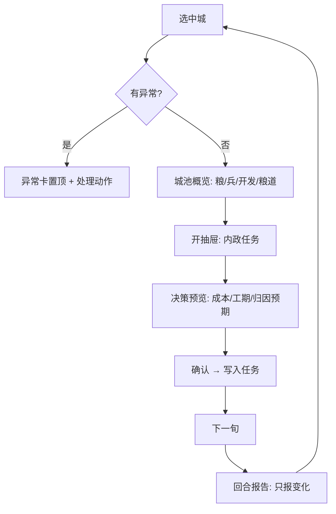
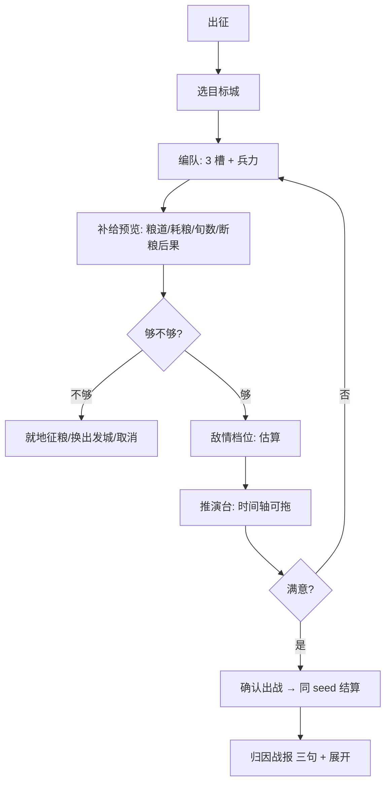

# 《穿越·汉末》顶配详细设计（GDD）

> **文档性质**：可执行规格。每一条都能追到「哪个文件、哪个字段、怎么验收」。
> **版本**：v1.1 · 2026-11-13（第二轮自审后修订，修订清单见附录 C）
> **上游**：`slgclient-三国SLG顶配设计方案.md`（v1.0，设计与取舍）、`slgclient-三国SLG交互原型设计提示词.md`（v2，交互规格）
> **下游**：`offline/docs/`（工程文档）、`conf/`（数据表）、`server/domain/`（模块）
> **证据分级**：`[A]` 官方一手 ｜ `[B]` 权威媒体 ｜ `[C]` 社区多源 ｜ `[D]` 待核实 ｜ `【判断】` 本文设计推导 ｜ `【现状】` 已从代码/配置核实的事实

---

## 目录

| 章 | 内容 | 谁该看 |
|---|---|---|
| 0 | 文档关系、现状基线、三个纠偏、三层可逆性 | 所有人先读 |
| 1 | 三个词 → 九条机制、与塔尖对比、冲突判例 | 策划 / 制作人 |
| 2 | 首 10 分钟 / 首小时 / 十小时 / 百小时 | 策划 /  UX |
| 3 | 循环数值化、点击预算、失败态、结局 | 策划 |
| 4 | 地图模型、城池字段、关隘、剧本分配 | 关卡 / 后端 |
| 5 | 时间、双账本、粮道、内政、征兵、委任、建言、外交、派系、经济 | 系统策划 / 后端 |
| 6 | 编制、公式、战法、克制、士气、推演台、归因、特殊战 | 战斗策划 / 内核 |
| 7 | 240 武将、三维人事、关系网、宿命、获取链、叛逃、死亡 | 内容 / 系统 |
| 8 | 事件 schema、DSL、冲突检测、出戏防线、六剧本开局 | 叙事 / 内容 |
| 9 | 参数表、难度、NPC 公平、平衡脚本 | 数值 |
| 10 | 布局、组件、流程、反馈、无障碍、合规、文案 | UX / 前端 |
| 11 | 模块映射、字段契约、确定性、存档、性能、测试 | 后端 / QA |
| 12 | 内容管线、剧本分配前置 | 制作人 |
| 13 | 风险、未决问题 | 所有人 |
| 14 | 里程碑到文件级、入仓步骤 | 项目管理 |
| 15 | 一页纸 | 决策者 |
| 附录 | 差异表、验收清单、自审记录 | QA / 评审 |

---

## 0. 怎么读这份文档

### 0.1 三份文档的权威顺序

冲突时按此裁决，不要来回改：

| 顺序 | 文档 | 管什么 | 不管什么 |
|---|---|---|---|
| 1 | `offline/docs/ARCHITECTURE.md` | 代码放哪、谁调用谁 | 玩法数值 |
| 2 | 本文 | 系统怎么运作、字段怎么定义、怎么验收 | 界面像素级布局 |
| 3 | 交互提示词 v2 | 界面组件的行为规格 | 系统数值与规则 |
| 4 | 顶配设计方案 v1.0 | 定位、取舍、借鉴来源 | 落地细节 |

**本文对上游方案有 3 处纠偏**（见 §0.2 与 §14 的 D-01/D-02/D-03），凡本文明写的，以本文为准；改上游结论必须写明理由。

### 0.2 现状基线（先承认现状，再谈设计）

以下全部来自代码与配置实测，不是估计【现状】：

| 项 | 实测值 | 出处 |
|---|---|---|
| 城池节点 | **72** 个（州治 13 / 郡治 59 量级，`adminLevel` 为细粒度描述） | `conf/campaign/strategy/map.json` |
| 路网 | **117** 条 `routes`；另有 `detail.json` 的 `march.nodes/edges` 支撑关隘绕行与封锁 | `march.js` |
| 关隘 | **不是城池节点**，是路网节点上的闸门，状态仅「通行/封锁」，封锁则前后两段同时禁行 | `march.js:isGateBlocked` |
| 战略回合 | **10 日 = 一旬**（`turnDays: 10`），不是一月 | `factions.json` |
| 势力 | **8 个**有人格脑的诸侯 + 汉廷中立；`trait` 只支持 4 个数值字段（`yields/recruitPct/upkeepPct/marchDelta`） | `factions.json` |
| 战法 | **51** 条（主线 31 + 库 20），每条含 `ui`（描述/目标/距离/等级成长）与 `kernel`（内核参数）双份 | `conf/skills.json`、`library-skills.json` |
| 战斗编制 | 每方 **3 个兵种槽**（`slot 0~2`）＋兵力/士气/战法三态，**不是 18 个独立棋子** | `battle.js:244`、`battle-core` |
| 粮道 | 已实现：以都城为根的**己方城连通性 BFS** + 断粮惩罚（民心 −3、治安 −1、守军 −2%/旬）+ 出征粮草预估（0.1 粮/兵/日） | `supply.js` |
| 内政任务 | 已实现任务对象：5 类（开垦/招商/募兵整编/修城/赈灾），10 日一 tick，工期随官员属性浮动，可撤销 | `interior-task.js` |
| 人事三维 | 已实现相性（1–149 环形，势力锚点 + cfgId 散列）、义理（政治/魅力折算）、登庸成功率构成条 | `relation.js` |
| 术语 | **67** 条，带 `证据级别/source_id/confidence` | `conf/interaction/terms.json` |
| 字段缺口 | 3 项未实装：玩家主动结亲/结义、敌方侦察精确值、逐将战前 delta | `interaction.js:fieldGaps` |
| 测试 | 38 个测试文件（`node --test tests/*.test.js`） | `tests/` |

**这条基线决定了本文的写法**：凡标【现状】的，只写「改哪里、加什么字段、怎么验」；凡标【待建】的，才写完整设计。**不重写已能跑的东西。**

### 0.3 三个纠偏（本文 v1.0 即生效）

**D-01｜「18 单位完全信息」不适用本作。**
上游方案按全战三国 3 将 × 6 部曲推出 18 个单位、并类比 ITB 的 8×8 棋盘。但本作内核是 `3 槽位 + 逐回合结算`，没有棋盘坐标。若硬造 18 个棋子，等于重写内核（违反「不改内核」约束），而且与"确定性可回放"要重跑一遍黄金向量。
**裁决**：推演台不做「棋盘推演」，做「**回合时间轴推演**」——把每一回合的三槽位状态、战法发动、伤害、士气变化逐帧列出，可前后拖动。完全信息仍然成立，因为它公开的是**同一套结算的逐步结果**，而非空间位置。详见 §6.7。

**D-02｜战略回合是「旬」，不是「月」。**
上游写「回合 = 一月，四季影响…」。现状 `turnDays = 10`，一年 36 回合。改为旬的好处：粮道/行军/内政 tick 全部以 10 日为节拍，与 `TICK_DAYS = 10` 一致；若改回月，粮耗与行军天数要整体重算。
**裁决**：战略回合 = **旬**；「月」只用于俸禄/政策结算与季节判定（3 旬 = 1 月，界面按月聚合展示）。**不改编排**，只改文档口径与 UI 文案。

**D-03｜关隘不是城。**
上游把「关隘」列为城池层级之一，会诱导实现者去新增 73 个节点。现状关隘是 `detail.json` 里的路网节点 + `gateStatus`。
**裁决**：关隘是**边的属性**，玩法上用「封锁/通行」两个状态 + 一次攻城战（打关）实现，不占城池名册、不产出资源、不驻官。详见 §4.4。

### 0.4 一条总律：三层时间尺度，三种可逆性

这是全案最容易写错的地方。不同层级的「可撤销」含义不同，混用会导致存档损坏或玩家钻空子：

| 层 | 时间尺度 | 可逆范围 | 为什么 |
|---|---|---|---|
| 战术层（推演台） | 单场战斗 | **无限回退**，只读沙箱，不写状态 | 推演不产生后果，回退零成本 |
| 战略层（本旬操作） | 1 旬 | **本旬内撤销最近 5 步**，跨旬清空 | 跨旬撤销等于时间旅行，会与 NPC 已执行决策冲突 |
| 世界层（归属/城址/死亡） | 全局 | **不可逆**，只能通过后续玩法改变（如复国） | 不可逆才让选择有重量；这是文明 6 那条设计律 |

**判据**：任何一个「撤销」按钮，必须能回答"它撤的是哪一层的状态"。答不出来就是设计没想清。

---

## 1. 定位怎么落成机制

### 1.1 三个词 → 九条可验收机制

口号不能验收，机制才能。把「可推演 / 可撤销 / 有记忆」拆成 9 条，每条都有判据：

| # | 机制 | 归属 | 验收判据（可自动断言） |
|---|---|---|---|
| 1 | 战前推演与正式结算**逐字节一致** | 可推演 | 同种子跑 100 次，预演战报与正式战报 `hash` 相同 |
| 2 | 出征前给出**粮道/耗粮/可支撑旬数/断粮后果**四件套 | 可推演 | 出征确认页缺任一项即视为未完成 |
| 3 | 每回合给出**归因报告**（谁/做了什么/为什么/变了多少） | 可推演 | 任一项数值变化必须有 `source` 字段，无 source 的 delta 不允许渲染 |
| 4 | 本旬操作**可撤销最近 5 步**，撤销后回到原视口与选中态 | 可撤销 | 撤销 5 次后状态 hash 与操作前一致 |
| 5 | 撤销**不覆盖**结算、战斗结果、已处决武将、已花出的钱 | 可撤销 | 战斗后撤销栈被清空（有断言） |
| 6 | 人物**记住**被谁释放/背叛/处决，并在关系网与后续事件中体现 | 有记忆 | 释放俘虏后 3 旬内，该武将关系值有可查变化 |
| 7 | 派系专业**改变决策**（同一按钮不同后果），不是数值加成 | 有记忆 | 4 个派系对同一动作的后果表不同（有对照测试） |
| 8 | 事件从**关系阈值**触发，每局可不同 | 有记忆 | 同一剧本两次开局，事件序列不完全相同（有采样测试） |
| 9 | 断粮/叛逃/灾害**提前一回合预报**，且给可执行应对 | 可推演 | 无「回合开始即扣血且无预警」的路径 |

> **反例防线**：只要出现"点完才知道结果"的一次性路径，第 1、2、9 条同时失效。所以本文所有代价性操作都强制走 `preview → confirm` 两段式，见 §10.3。

### 1.2 与塔尖五款的不重复论证

| 能力 | CK3 | 全战三国 | 三国志14 | 文明6 | ITB | **本作** |
|---|---|---|---|---|---|---|
| 确定性可回放 | ✗ | ✗（实时） | 部分 | ✓（种子） | ✓ | **✓（内核级）** |
| 战前推演 | ✗ | ✗ | ✗ | ✗ | ✓（棋盘） | **✓（时间轴）** |
| 战略层撤销 | ✗ | ✗ | ✗ | ✗ | ✓ | **✓（本旬 5 步）** |
| 人物叙事密度 | ✓✓ | ✓ | ✓ | ✗ | ✗ | ✓（关系驱动） |
| 史实地图 | ✓ | ✓ | ✓✓ | ✗ | ✗ | ✓（72 城可考） |
| 粮道可视化 | ✗ | 部分 | ✓✓ | ✗ | ✗ | ✓（连通 + 断点） |

**结论**：唯一同时打满前三列的是本作。这不是"功能更多"，而是"前三列互为前提"——没有确定性就没有推演，没有推演就没有敢撤销的底气。

### 1.3 支柱冲突的裁决记录（真实案例，供后续参考）

设计冲突不能靠感觉，要有判例。以下 4 条是本文实际裁决过的：

| 冲突 | 双方 | 裁决 | 理由 |
|---|---|---|---|
| 预演是否消耗资源 | 拟真 vs 公平 | **不消耗、不限次** | 预演不产生收益，限制它只会让玩家去读档，反而更破坏体验 |
| 高难度是否藏信息 | 挑战 vs 公平 | **不藏**，只加 AI 强度与资源压力 | 藏信息 = 系统坑我，直接违反第 9 条判据 |
| 撤销是否可跨旬 | 便利 vs 一致 | **不可** | 跨旬撤销要回滚 NPC 已执行决策，等于要求世界状态可倒流 |
| 史实人物能否被玩家杀死 | 史实 vs 自由 | **能，但写入履历并触发历史偏移** | 不能杀 = 玩家没有主体性；杀了不记录 = 出戏 |

---

## 2. 玩家旅程与节奏

### 2.1 首 10 分钟（分秒脚本，必须逐条实现）

目标：**在 10 分钟内完成一次「选城 → 下令 → 看到变化」的闭环**，且不出现任何未解释名词。

| 时间 | 屏幕 | 玩家做什么 | 系统必须做什么 | 判据 |
|---|---|---|---|---|
| 0:00–0:40 | 开局幕（一页文本 + 一张地图） | 读 3 句话，点「举义」 | 显示当前势力、目标、唯一一个可点按钮 | 屏幕上可点元素 ≤3 |
| 0:40–1:30 | 大地图（相机推到本城） | 看 | 高亮本城，其余灰化 30%；顶部「当前事务」出现 1 条 | 首条建言必须可一键执行 |
| 1:30–3:00 | 城池抽屉（就地） | 点「开垦」 | 弹出决策预览：花 300 金、2 旬、官员加成、预计 +3 农田 | 预览含"如果钱不够会怎样" |
| 3:00–4:30 | 时间推进 | 点「下一旬」 | 分步结算动画：田赋 → 内政 → NPC → 报告 | 结算不超过 2.5 秒 |
| 4:30–6:00 | 回合报告 | 读 3 行 | 只报变化项，异常置顶，可点「回跳现场」 | 报告 ≤5 行，无「无变化」噪音 |
| 6:00–8:30 | 出征（第一次战斗） | 选目标城 → 编队 → 看补给 | 出征预览四件套 + 战力对比（估算档） | 不确认不能出兵 |
| 8:30–10:00 | 战报 | 读归因三句 | 「第 2 回合你少了 300 弓兵，因为…」 | 归因必须指到具体决策 |

**反模式**：不要用「教学弹窗连续 8 页」。CK3 的爱尔兰教学成功在于**边玩边教**，不是先上课。本文要求：每条教学提示必须绑定一个玩家**即将做的动作**，做完即消失，不重复。

### 2.2 首小时：第一场战役的六道门

一场战役 45–90 分钟，必须按顺序过六道门，每道门有"玩家此刻应该产生的念头"：

| 门 | 触发 | 玩家念头 | 系统支撑 |
|---|---|---|---|
| 1 动机 | 建言提示「邻城守军仅 800」 | 「打它有赚」 | 目标城收益预览（粮/兵源/特产） |
| 2 集结 | 点「出征」 | 「我带谁去、带多少粮」 | 编队页 + 粮道条 + 可支撑旬数 |
| 3 行军 | 确认后 | 「路上会不会被截」 | 行军线 + 途经关隘状态 + 敌情档位 |
| 4 遭遇 | 抵达 | 「这仗能不能打」 | **推演台**（本作独有） |
| 5 结算 | 确认 | 「我哪步错了」 | 归因战报 + 逐回合明细 |
| 6 消化 | 占城 | 「这座城怎么用」 | 城池三层面板 + 委任建议 |

**关键**：第 4 门是留存分水岭。玩家在这里第一次意识到"我可以先试"。所以推演台必须在**第一次战斗之前**就被引导打开一次（不是强制，是建言里给一条「先推演看看」）。

### 2.3 首 10 小时：一个剧本的五幕

以「讨董 190」为例（其他剧本同构）：

| 幕 | 旬数 | 玩家状态 | 必须出现的新东西 | 反疲劳手段 |
|---|---|---|---|---|
| 偏安 | 1–6 | 1–2 城，穷 | 内政任务、粮道概念、第一个在野武将 | 每旬一个新名词解释 |
| 崛起 | 7–20 | 3–6 城，第一次硬仗 | 委任、外交、派系资源、第一次断粮 | 第一次「以少胜多」机会 |
| 相持 | 21–45 | 6–15 城，两线 | 人事博弈（离间/招降）、灾害、叛逃预警 | 宿命事件首次触发 |
| 破局 | 46–70 | 15–30 城 | 大军团、关隘争夺、粮道战 | 强敌崛起（NPC 脑锁定目标） |
| 收束 | 71+ | 30+ 城 | 统一或阶段目标达成 | 结局分歧（史实/改写） |

**硬规则**：任意连续 20 分钟内，必须至少出现 **1 个新信息**（新名词/新机制/新人物/新事件）。做不到就是内容不足，不是节奏问题。

### 2.4 百小时：重开理由

不做赛季、不做随机地图，重开靠四件事：

1. **剧本差异**（6 个，核心矛盾不同）。
2. **势力差异**（4 套派系专业 × 6 剧本）。
3. **关系驱动事件**（同剧本不同局，事件序列不同）。
4. **宿命选择**（24 组，触发与否取决于你用了谁）。

**反面**：8R 用 1000 武将 + 55 剧本换内容量，结果被批"重复感强"[C]。本作宁可 240 位里 60 位有专属内容。

---

## 3. 核心循环的数值化定义

### 3.1 分钟循环与点击预算

单回合 3–8 分钟，**有效点击 ≤12 次**。预算是硬约束，超了必须砍流程而不是加自动化：

| 动作 | 点击 | 说明 |
|---|---|---|
| 读建言 + 选第一条 | 2 | 建言卡直接带「执行」 |
| 城池开发（2 城） | 4 | 每城：开抽屉 1 + 选任务 1 |
| 出征（1 次） | 3 | 选城→编队确认→出征 |
| 处理 1 条异常 | 1 | 报告里直接「去处理」 |
| 推进回合 | 2 | 下一旬 + 确认（有未处理项时才确认） |
| **合计** | **12** | 留 0 余量，说明上面每一项都不能再加一步 |

**反模式清单**（出现即打回）：
- 每回合必须巡检 72 城（应为「异常才告警」）。
- 打开一个面板才能看到结果（应为就地预览）。
- 为了看一个数字跳三次页（数值来源两跳内可达）。
- 同一个数字在两个地方各算一遍（见 §11.2 单一权威源）。

### 3.2 小时循环的六阶段门（已见 §2.2，此处定义门禁）

每道门有**进入条件**与**退出条件**，不满足不许进入下一阶段（这是流程状态机，不是文案）：

| 门 | 进入条件 | 退出条件（写入存档字段） |
|---|---|---|
| 集结 | 有 ≥1 支可动部队、目标城已选 | `order.from/to/troops/grain` 齐备 |
| 行军 | 粮道预估 `enough=true` 或玩家显式接受风险 | `movements[]` 有 ETA |
| 遭遇 | 抵达且双方兵力 >0 | 进入 `battle.pending` |
| 推演 | `battle.pending` 存在 | 玩家 `confirm` 或 `cancel` |
| 结算 | `confirm` | 战报写入 `state.battleLog`，状态落库 |
| 消化 | 战报已出 | 占城/抚民/收将任一处理完 |

### 3.3 「无事可做」检测（防节奏断裂）

每旬结算后运行一次检查，若以下四项全为否，则必须生成一条「机会建言」（否则玩家会对着空地图发呆）：

```
有可开发城（金 ≥ 最低任务成本）
∨ 有可招募武将（在野池非空）
∨ 有可打目标（相邻敌城守军 < 我方 1.5 倍）
∨ 有可处理异常（粮道断/民心低/欠饷）
```

**判据**：连续 2 旬四项全否 = 内容或数值出问题，进 bug 列表。这不是体验建议，是可断言的规则。

### 3.4 失败态与恢复（第二轮补丁）

单机游戏没有客服兜底，玩家一旦陷入"死局"就会弃游。必须显式设计四种失败态及其**出路**：

| 失败态 | 判定 | 玩家能做什么 | 禁止 |
|---|---|---|---|
| **破产**（金 < 0 且粮 < 500） | 旬结算 | 裁军（返还 30% 金）、卖粮、弃城减俸、向盟友借（attitude ≥40） | ❌ 自动扣到负数后无事发生 |
| **兵尽**（城守军 < 200 且无在野可征） | 每旬检查 | 紧急征兵（民心 −10）、雇雇佣兵（贵 3 倍）、固守待援 | ❌ 直接判负 |
| **无将**（可用武将 = 0） | 出征前 | 自动生成「代将」（五维 50、无战法）、释放俘虏换将、招募在野 | ❌ 无法出征 |
| **都城失陷** | 即时 | 迁都（保留 50% 资源）、流亡政府（只能守 1 城） | ❌ 立即亡国（现状 `supply.js` 已 `exempt`，与此一致） |

**「代将」设计说明**：这是防止"武将全死导致游戏无法继续"的兜底，不是玩法。代将不可培养、不可升官、不能触发宿命，且在有名将可用的城里会被玩家主动替换。**必须有**，否则一次连环阵亡就能毁掉一局 20 小时的存档。

**恢复感原则**：任何失败态都必须给"至少一条能活下来的路"，哪怕很贵。玩家可以输，但不能"卡住"。

### 3.5 结局判定（第二轮补丁）

| 结局 | 条件 | 呈现 |
|---|---|---|
| **统一** | 占领全部州治 + 消灭主要势力 | 天下图 + 势力年表 + 关键人物结局 |
| **偏安** | 达到剧本阶段目标（如"保有荆益 10 年"） | 一页史评 + 未完成的事 |
| **败亡** | 所有城失陷且无可迁之都 | 履历式总结（不是"Game Over"三个字） |
| **改写（隐藏）** | 关键史实人物存活且达成特定条件（如关羽未死 + 荆州未失） | 与正史对照的"本局轨迹"，附史实出处 |

**共同要求**：结局必须回放"你做过的 5 个关键决定"，并给出史实对照。这是"有记忆"的最后一次兑现，也是玩家愿意重开的理由——他想的不是"再赢一次"，而是"换一条路看看"。

**不做**：不做"通关评分/排行"，单机评分会诱导玩家去刷而不是去体验。

---

## 4. 世界与地图

### 4.1 空间模型：节点-边，不是六边形格

**为什么不学文明 6 的格子**：本作是 72 个史实城 + 117 条史实道路。格子化会逼玩家在"真实地理"和"可玩网格"之间二选一，而这正是全战三国被简中玩家批评"不够史实"的同类问题。节点-边模型能直接吃《续汉书·郡国志》的郡县关系，且关隘天然是边上的闸门。

**代价（必须承认）**：
- 没有"绕后包抄"这种自由机动，只有"多路并进"。
- 地图看起来不像"棋盘"，需要更强的视觉引导（见 §4.6）。

**收益**：地名、里程、关隘全部可考；行军天数可用真实里程折算，粮道可画。

### 4.2 城池数据模型（现有 20 字段 + 新增 8 字段）

现有字段（`map.json`，已核实）：`id / ref / name / alias / province / provinceId / level / levelName / adminLevel / terrain / isIsland / x / y / width / height / population / attrs{民心,繁荣,农业,商业,城防,兵源,水运,治安,开发度,战略价值,灾害风险} / history / gameName / jun / today / specialty / arms / model / provinceCapital / disasterBasis`

新增 8 个（**只加不删，旧档 `ensureCityEcon` 兜底**）：

| 字段 | 类型 | 单位/范围 | 权威源 | 用途 | 缺省 |
|---|---|---|---|---|---|
| `cityFeature.level` | enum | capital/jun/county/gate/port | 静态表 | 层级加成 | 由 `adminLevel` 推导 |
| `cityFeature.regions` | int | 2–4 | 静态表 | 可建区域数（不可逆） | 3 |
| `cityFeature.specialArms` | string[] | 见 §6.5 | 静态表 | 虎符解锁特殊兵 | `[]` |
| `cityFeature.inTheWild` | string[] | 武将名 | 静态表 | 在野池 | `[]` |
| `econ.store` | number | 粮，≥0 | `city-econ.js` | 城库存粮（双账本） | 0 |
| `econ.garrison` | number | 兵，≥0 | `strategy.js` | 守军（与 `troops` 区分） | 由 troops 迁移 |
| `econ.supplyCut` | bool | — | `supply.js` | 是否断粮 | false |
| `econ.devSlots` | object | 见 §5.4 | `interior-task.js` | 开发度四项 | 0 |

> **一致性要求**：`attrs` 是"展示用基准值"（0–100），`econ` 是"运行期真值"。界面必须显示 `econ` 推导后的值，并且标注「基准 X → 当前 Y（+来源）」。两者混用会重演「全城显示 0 粮」那类事故【现状教训】。

### 4.3 五类城池模板（数值表）

不是 72 个同质数字，而是 5 套模板 + 个体差异。模板只定义**比例关系**，个体值来自 `map.json` 实测值（如长安人口 68000、农业 87、商业 100）。

| 类型 | 数量 | 粮 | 金 | 兵源 | 城防 | 特殊 | 玩法定位 |
|---|---|---|---|---|---|---|---|
| 州治 | 13 | ×1.25 | ×1.25 | ×1.20 | ×1.30 | 全局+1 政策槽 | 必争，失之则一州动摇 |
| 郡治 | ~55 | ×1.00 | ×1.00 | ×1.00 | ×1.00 | 无 | 基本盘 |
| 县治 | ~4 | ×0.75 | ×0.75 | ×0.85 | ×0.85 | 低成本开发 | 填充与跳板 |
| 港口（属性） | 沿江/海 | 粮 ×0.9 | 金 ×1.2 | — | — | 水运 +30，可通水路 | 水军与漕运 |
| 关隘（非城） | 路网节点 | — | — | — | 守方 ×1.5 | 封锁两段 | 以少守多 |

**个体差异来源（按权重）**：`attrs.农业/商业`（0.5）＋ `specialty`（0.3）＋ `provinceCapital`（0.2）。**不允许**为每城手写一套产量，否则 72 城无法平衡。

### 4.4 通路的四种状态与关隘规则

一条边（路）只有四种状态，界面必须能一眼区分：

| 状态 | 判定 | 视觉 | 玩法后果 |
|---|---|---|---|
| 通 | `edgePassable = true` 且两端己方 | 实线（势力色） | 可行军、可运粮 |
| 断 | 任一端非己方，或关隘封锁 | 虚线 + 断点图标 | 不可通行；已方城若被切断则断粮 |
| 需解锁 | 关隘 `gateStatus = 通行` 但关隘属敌方 | 线 + 锁图标 | 需先打关（一次攻城战） |
| 季节封冻 | 冬 + 江河边（`crossRiver = true`） | 冰纹线 | 可通行但粮耗 ×1.3、不可火攻 |

**关隘的三条硬规则**（对齐 `march.js` 现状）：
1. 关隘是路网节点，路过必须"连走两段"，不能跳过。
2. 封锁即前后两段同时禁行，不存在"只堵一边"。
3. 打关 = 一次普通攻城战，但守方城防 ×1.5、攻方兵力展开受限（最多 2 槽接战）。

**为什么不做"关隘驻军独立管理"**：那会引入第三套部队体系（城军/关军/野战军），与粮道、编制、补给全部要重算。**一支部队只能属于一座城**，关隘只提供修正。这条要写进代码注释，防止后来者"顺手加个关隘驻军"。

### 4.5 初始局势：6 剧本 × 势力

完整分配在 `conf/campaign/strategy/scenarios/*.json`【待建】。本文只锁规则与抽样，防止实现时自由发挥：

| 剧本 | 年份 | 玩家默认势力 | 核心矛盾 | 独有规则 |
|---|---|---|---|---|
| 黄巾 | 184 | 皇甫嵩/刘备/曹操（三选一） | 平叛 vs 割据 | 黄巾城不可常规开发，靠「圣所」产兵，镇压后转民城 |
| 讨董 | 190 | 曹操/孙坚/袁绍 | 联军 vs 各怀鬼胎 | 联军声望：攻董卓得，抢地盘失；声望 <0 被踢出联军 |
| 官渡 | 200 | 曹操/袁绍 | 强弱逆转 | 乌巢粮仓为特殊节点，焚毁则袁军全线断粮 |
| 赤壁 | 208 | 孙权/刘备/曹操 | 南联 vs 北压 | 水战规则启用；疫病按季节概率；火攻需东南风预报 |
| 夷陵 | 221 | 刘备/陆逊 | 复仇 vs 国运 | 山地连营：补给距离惩罚 ×2，七百里连营可被火攻 |
| 三分 | 229 | 魏/蜀/吴 | 稳态对峙 | 国力差距大，弱方靠关隘与粮道守；北伐/防守目标不同 |

**开局规则（六个剧本共用）**：
- 玩家初始 **1 城**（黄巾/讨董）或 **3 城**（官渡及以后），保证第一次扩张在 10 分钟内可完成。
- 开局 3 旬内必有一个「必须马上做的决定」（缺粮/邻军压境/盟友求援三选一）。
- **不允许**开局就给一堆待处理事务（>3 条），那会直接违反 §3.1 的点击预算。

### 4.6 地图可读性（LOD 与 token 预算）

| 缩放 | 显示 | token 上限 | 说明 |
|---|---|---|---|
| 战略视角（全图） | 州界 + 州名 + 己方城点 + 敌情档位色块 | 40 | 不显示单个武将 |
| 战役视角（一州） | 全部城名 + 守军数 + 路网 + 粮道 | 120 | 默认视角 |
| 战术视角（一郡） | 关隘 + 行军线 + 部队 + 补给节点 | 60 | 出征时自动切 |

**性能硬指标**：任一视角，`DOM 节点增量 ≤ 400`、相机移动时 `重绘 ≤ 16ms/帧`。超了先降 LOD，不许减信息种类（减种类会让玩家以为信息消失了）。

---

## 5. 战略层详细设计

### 5.1 时间模型（旬 / 月 / 季 / 年）

```
1 旬 = 10 日（战略回合，turnDays=10）
1 月 = 3 旬（俸禄、政策月费、季节判定的结算点）
1 季 = 3 月（9 旬）：春夏秋冬
1 年 = 12 月 = 36 旬
```

| 事件 | 节拍 | 结算内容 |
|---|---|---|
| 旬结算 | 每回合 | 田赋入城库、内政任务推进、NPC 决策、粮道检查、灾害判定 |
| 月结算 | 每 3 回合 | 俸禄、政策月费、民心自然回归、人口增长 |
| 季结算 | 每 9 回合 | 农时（春耕/秋收）、征兵上限调整、疫病判定 |
| 年结算 | 每 36 回合 | 年龄 +1、寿命判定、史实节点推进 |

**顺序不可换**（换顺序会改变结果，是确定性回归的高发点）：`田赋 → 内政 → 粮道 → 灾害 → NPC → 月/季结算 → 报告`。

**界面口径**：主界面显示「第 N 旬 · 建安五年 三月」，不显示"回合 N"。玩家心里的单位是时间，不是计数器。

### 5.2 双账本：军粮留城，金钱上缴

**现状【现状】**：存在两套粮食数字——`state.strategy.resources[faction].grain`（全国账）与 `state.strategy.cityEcon[id].store`（城库）。`accrueFactionGrain` 在给全国账加粮，`consumeMarchGrain / deliverGrain` 在动城库。**两套并存是历史产物，不是设计。**

**目标态**（M2 完成）：

| 资源 | 权威源 | 流动 | 界面 |
|---|---|---|---|
| **金** | 国库 `resources[faction].gold` | 各城产金 → 全额上缴 → 统一支付 | 顶栏一个数 |
| **粮** | 城库 `cityEcon[id].store` | 各城留粮 → 跨城调运有损耗 → 出征就地取粮 | 城面板 + 粮道透镜 |
| **兵** | 城 `troops`（守军）与部队 `movements`（野战） | 征兵在城，出征抽走 | 城面板 |

**迁移三步（不许一步到位）**：

1. **M1 双读一致**：所有对外视图的粮只取 `cityEcon.store` 汇总，`resources.grain` 降级为"显示用合计"，并在 `fieldGaps` 标注。目的：先把"显示 0 粮"类事故堵死。
2. **M2 切断写入**：`accrueFactionGrain` 改为写各城 `store`（按城的田赋产出分配），全国账只读汇总。
3. **M3 删除全国粮账**：旧档迁移时把 `resources.grain` 按城数均摊入 `store`，写 `migrationLog`。

**跨城调运规则**（M2 起生效）：

```
调运量 = min(源城余粮 - 源城 3 旬口粮, 目标需求)
在途损耗 = 调运量 × 距离系数（每 100 里 2%，上限 30%）
被截概率 = 途经敌方控制边数 × 8%（有护航部队则减半）
到达 = 调运量 × (1 - 损耗) × (1 - 被截损失)
```

**为什么必须做**：若粮草全国通用，72 城就退化成一个大省，"粮道"只剩视觉装饰，第 4 条差异化亮点直接消失。

### 5.3 粮道：从「连通性」到「断点」三级演进

**现状【现状】**（L1 已实现）：`supply.js` 以都城为根做 BFS，判定每座己方城是否与都城连通；断则民心 −3/旬、治安 −1/旬、守军 −2%/旬；都城丢失时全部 `exempt`（避免亡国流程中叠加惩罚）。

| 级别 | 判定对象 | 玩家看到的 | 何时做 |
|---|---|---|---|
| **L1 城级连通** | 城 ↔ 都城 | 城点变红 + 「粮道断」图标 | 已实现 |
| **L2 军级补给线** | 出征部队 ↔ 最近己方补给节点 | 行军线上的补给带，断点标红 | M2 |
| **L3 节点容量** | 节点吞吐 vs 过境需求 | 节点旁数字 + 溢出箭头 | M3（可选） |

**L2 的判定规则**（本文新增，必须与 NPC 共用同一函数）：

```
补给节点 = 己方城（store > 0）∪ 己方控制关隘
部队补给状态：
  if 部队位置与某补给节点在同一条可行军路径上，且路径未被敌方控制
     → 通畅；每旬按 0.1 粮/兵 就地扣该节点 store
  else
     → 断绝；士气 −5/旬，3 旬后开始逃兵（−2%/旬）
```

**L3 容量**（可选，做之前先验证玩家是否需要）：
- 节点容量 = `基础 2000 + 城防 × 20 + 州治加成 1000`。
- 过境需求 = 所有经过该节点的部队日耗之和。
- 溢出：超出部分转嫁到下一节点，仍不足则前线部队按缺口比例扣士气。
- **风险**：容量规则会让玩家开始算表格。所以 L3 必须默认关闭，作为「硬核模式」可选项，且所有超载必须可视化（节点数字变黄 + 悬停给出明细）。

**断粮惩罚链**（替换现状的"直接扣"）：

```
第 1 旬：士气 −5，界面黄条警告，给两个应对（就地征粮 / 撤退）
第 2 旬：士气 −10，战法发动率 −10%，出现"逃兵预警"（可花金安抚）
第 3 旬：守军/部队 −2%/旬，民心 −3，强制弹出「弃城 or 突围」二选一
```

**判据**：任何一旬的惩罚都必须伴随**一个可执行动作**。只扣数值不给动作 = 违反 §1.1 第 9 条。

### 5.4 内政任务状（现有 5 类 → 12 类 → P11 修订为 13 类）

**现状【现状】**：`interior-task.js` 已有 5 类（开垦/招商/募兵整编/修城/赈灾），`TICK_DAYS = 10`，`planTicks(kind, stat)` 按官员属性浮动工期，任务可撤销。

**目标态 12 类**（新增 7 类，全部走同一任务对象，不新建系统）。

> **P11 修订（2026-11-13）**：为落实「内政需要先发展人口、征兵不能竭泽而渔」，再补第 13 类 `populate`（劝课生息）。它不新建系统，仍走 `interior-task.js` 的同一任务对象与 `KINDS` 表；下文表格与「12 类」的表述按本修订理解为 **12 + 1 = 13 类**。这是用户明确要求纠正的偏差，不要回退。

| 类 | 成本 | 工期（旬） | 效果 | 依赖属性 | 备注 |
|---|---|---|---|---|---|
| 开垦 | 300 | 2 | 农田开发 +3 | 政治 | 现有 |
| 招商 | 300 | 2 | 市集开发 +3 | 政治 | 现有 |
| 募兵整编 | 350 | 2 | 兵营开发 +3、民心 +1 | 城防 | 现有 |
| 修城 | 400 | 2 | 城防 +2、治安 +2、守军 +150 | 武力 | 现有 |
| 赈灾 | 500 | 立即 | 解除减产、民心 +6、治安 +3 | 政治 | 现有 |
| **兴学** | 600 | 3 | 该城每年 +1 名在野候选 | 智力 | 新增：人事供给 |
| **招抚** | 450 | 2 | 治安 +5、该城叛逃概率 −30% | 魅力 | 新增：维稳 |
| **屯田** | 500 | 3 | 农田 +2 且城库 +800 粮 | 政治 | 新增：军粮 |
| **练兵** | 550 | 3 | 该城出征部队初始士气 +10 | 武力 | 新增：战术前置 |
| **修路** | 700 | 4 | 指定一条相邻边行军天数 −1（最低 1） | 政治 | 新增：改变路网 |
| **侦察** | 200 | 1 | 相邻敌城情报档位 +1（传闻→估算→精确） | 智力 | 新增：补情报 |
| **离间** | 800 | 2 | 目标敌将忠诚 −8、恩义 −10 | 智力 | 新增：人事战 |
| **劝课生息** `populate` | 400 | 2 | 本城人口 **+8%**、民心 +2 | 魅力 | **P11 新增**：招徕流民、增加户口。兵役制下「新增户才有新丁可征」，这是兵源枯竭后唯一的正向恢复手段 |

**工期公式**（沿用现有 `planTicks` 思路，本文写死口径）：

```
工期 = ceil(基准工期 × clamp(1 - (官员属性 - 60) / 200, 0.6, 1.4))
```

例：基准 2 旬、官员政治 96 → 2 × (1 − 36/200) = 1.64 → 2 旬；政治 30 → 2 × 1.15 = 2.3 → 3 旬。
**上限 40% 加速、40% 减速**，防止出现"神将一旬全做完"。

**任务对象 schema**（现有字段 + 3 个新增）：

```js
{
  id, cityId, kind, officerId,
  startTurn, ticksTotal, ticksDone,
  cost, status: 'running'|'done'|'canceled',
  perTick: { field, delta },      // 新增：每旬增量（可归因）
  reason: '玩家指派'|'委任'|'事件',  // 新增：来源
  cancelable: true                // 新增：结算类任务不可撤
}
```

**归因要求**：任务完成时写一条 `strategyLog`：`"长安 农田 +3（荀彧·政治 96，2 旬）"`。没有这一条，第 3 条机制（归因）就是空谈。

### 5.5 征兵与兵源（P11 修订：户役制）

**原口径的缺陷**：`可征上限 = floor(人口 × 0.06 × 兵源系数 × 季节系数 - 现有守军)` 把「人口」当成一个可直接抽兵的水池，允许每旬反复抽取，妇孺老弱也被算进兵源——用户 2026-11-13 第 4 项明确指出「不允许反复征兵 / 妇孺老少不能被征兵 / 一户征兵一位 / 内政需要先发展人口」。因此本节整体改为**户役制**，实现落在 `server/domain/levy.js`，是全局唯一权威源。

**户口 → 兵源推导**（常量全在 `levy.js`，任何 UI 不得另算）：

```
户数        = floor(人口 / HOUSEHOLD_SIZE)              HOUSEHOLD_SIZE = 5
适龄壮丁    = floor(户数 × ADULT_MALE_RATE)             ADULT_MALE_RATE = 0.62
免征户      = 户数 - 适龄壮丁                          妇孺老弱，只能看、不能征
已征户      = 城池台账 levied（累计，不随旬清零）
本户余丁    = max(0, 适龄壮丁 - 已征户)
本旬上限    = min(本户余丁,
                 floor(户数 × TURN_CAP_RATE × 季节系数),   TURN_CAP_RATE = 0.05
                 人口可承受额)
一旬一征    = city.lastLevyTurn === levyTurnOf(state) 时拒绝，不与「资源够不够」耦合
每丁人口代价 = POP_PER_SOLDIER = 4（征 1 丁，人口基数 −4）
季节系数    = 春 0.8 / 夏 1.0 / 秋 1.1 / 冬 0.7
```

**四条硬规则**（验收逐条对应 `tests/p11-levy-and-gates.test.js`）：

1. **妇孺老弱免征**：可征上限只从「适龄壮丁」里出，`exempt` 在兵役台账里显式可见，玩家能看懂为什么征不满。
2. **一户一丁**：`levied` 是累计已征户数，本户余丁耗尽后即使人口仍多也不能再征；**只有新增户口才带来新丁**。
3. **一旬一征**：`lastLevyTurn` 按战略旬记，同旬第二次 `army.conscript` 一律拒绝，不因资源充足而放行。
4. **先发展人口**：兵源枯竭时征兵页不给「重试」，而是给「去内政 · 劝课生息」按钮，跳到 §5.4 的 `populate`；完工人口 +8%、民心 +2，新户带来新壮丁。

**结算纪律**：`server/handlers.js` 先 `checkLevy()` 再 `tryUseNeed()`，失败**不扣资源**（旧实现先扣后查，玩家点了失败也掉金粮）；成功后 `commitLevy()` 写台账、扣人口、降民心。返回值带 `levy` / `levyCommit` / `farmConflict` / `levyNote`，供 UI 同源展示。六府内政页、城池内页「征兵」页签、战略视图全部从 `levyView()` 取数，禁止各算一份。

**农时冲突（保留且必须可见）**：春季征兵超过本旬上限的 50% → 秋收田赋 −15%，`farmConflictOf()` 在确认页**提前显示**。这是"选择有代价"的最小闭环：**用行为触发后果，而不是用弹窗说教**。

**便捷操作**（用户第 3 项）：征兵页提供「征 100 丁 / 征 300 丁 / 一键征满」三个按钮，一键征满按当前 `quota` 填数；不可征时按钮置灰并给出「劝课生息」去向。

**旧档兼容**：`world.strict === false` 且无逐城经济表时走降级口径，不让老存档开局即卡死；降级路径同样有测试。

### 5.6 委任：任务对象化，不做一键结算

```js
appointment = {
  id, officerId, cityId,
  goal: 'develop'|'recruit'|'defend'|'transport',
  startTurn, etaTurn,
  perTurn: { gold, grain, devAgri, ... },
  cost: { gold, grain },
  status: 'running'|'done'|'blocked',
  blockedReason: '缺金'|'缺粮'|'城失'|null
}
```

**执行规则**：
- 每旬自动生成一条**真实的内政任务**（走 `interior-task.js`，不另写逻辑），所以委任产出与手动操作完全同源。
- 缺资源时 `blocked`，并在报告里置顶（不静默跳过）。
- 城丢失 → 委任自动结束，写一条"XX 失城，委任中止"。

**为什么不做"一键结算整月"**：那会让玩家失去归因，也让撤销失去意义。委任的卖点是"我不用管，但我知道它在干什么"，不是"我不用玩"。

### 5.7 建言：玩家侧的"军师"，与 NPC 脑彻底分离

**现状【现状】**：`strategy-brain.js` 是 NPC 的战役规划脑（`planCampaign`），有 memory、persona、goal。**它不是玩家建言系统**，不要复用（复用会让 NPC 的目标泄漏给玩家）。

**建言卡 schema**：

```js
{
  id, kind: 'opportunity'|'warning'|'reminder',
  title: '可取陈留',
  action: { type:'march', from, to, troops },
  basis: ['守军 800', '我方可出 2400', '粮道 2 跳'],
  confidence: 'high'|'mid'|'low',   // 依据完整性，不是"AI 猜的准不准"
  expires: 3,                        // 几旬后失效
  source: 'rule:weak_neighbor'
}
```

**硬规则**：
- 每回合最多 **5 条**，按"可执行性 × 收益"排序。
- 每条必须有 `basis`（数字来源可点开）与 `expires`（会过期）。
- **不允许出现"必胜/必败"**；胜率只能给区间，且必须标注"基于公开规则推算"。
- 低可信度必须说明缺什么（"未侦察，守军为估算"）。

**反模式**：不要做"军师说打哪就打哪"的单一最优解。高智武将只提高**依据的完整度**（能看到更多 basis），不提高"正确率"。

### 5.8 外交：只对 NPC，全部可解释

**态度值模型**（每对势力一个 `attitude ∈ [-100, 100]`）：

```
attitude = 基础(史实关系) + 履约次数×5 - 背约次数×10
         + 联姻×15 + 赠礼(按价值) - 边境摩擦×3
         + 共同敌人×10 - 你占了他的城×20
```

**动作与门槛表**：

| 动作 | 门槛 | 代价 | 失败后果 |
|---|---|---|---|
| 停战 | attitude ≥ −30 | 金/粮 | 拒绝，attitude −5 |
| 通行权 | ≥ 20 | 金 | 拒绝 |
| 结盟 | ≥ 55 且无共同敌人冲突 | 人质/联姻 | 拒绝，且对方可能告知你的敌人 |
| 联姻 | ≥ 40 | 一名宗室女/子 | 拒绝，attitude −10 |
| 请求攻击 | ≥ 60 或盟友 | 承诺分赃 | 口头答应但可能不出兵（有 `betray` 标记） |
| 劝降 | 兵力比 ≥ 3:1 且 attitude ≥ 0 | 保留官职 | 拒绝则开战 |
| 离间 | 目标将恩义 ≤ 30 | 800 金 + 智力判定 | 被识破，attitude −15 |

**拒绝理由链（强制）**：任何拒绝必须返回 `{code, text, factors[]}`，例如：

> 「袁绍拒绝结盟：你与他的敌人曹操有通行协议（−20）；上月你夺取了黎阳（−20）；当前态度 18，未达 55。」

**没有理由链的外交回复一律视为 bug**。这是"可解释性"在战略层的落点。

### 5.9 派系专业 4 套（先做 4 个，验证后扩）

**现状【现状】**：`factions.json` 的 `trait` 只支持 `yields/recruitPct/upkeepPct/marchDelta` 四个数值字段。要支持"改变决策"，需要新增 `uniqueResource` 与 `decisionHooks`（本文新增字段，**不改旧字段**）。

| 势力 | 独有资源 | 获取 | 消耗/用途 | 决策改变（同一按钮不同后果） | 弱点 |
|---|---|---|---|---|---|
| **曹操** | 威权 / 信义（双向条，−100…+100） | 平叛+威权、履约+信义、挟天子+威权 | 威权：降附庸反抗、加速征兵；信义：外交门槛 −15 | **释放俘虏**：威权 → 敌方畏惧 +5；信义 → 该将登庸率 +20% | 双向条互相抵消，走极端会失去另一侧收益 |
| **刘备** | 仁望（0–100） | 抚民、释放俘虏、拒绝屠城 | 招募在野成功率 +仁望/2%；占城反抗 −仁望/3% | **屠城**：直接清空仁望，且 3 旬内所有在野武将拒绝出仕 | 起势慢；仁望低时无任何补偿机制 |
| **孙氏** | 江表威望（0–100） | 水战胜利、经营港口、平定山越 | 水军成本 −威望/2%；江东士族支持（额外政策槽） | **水战撤退**：威望 ≥50 可全身而退；<50 则损失半数辎重 | 陆战无加成；离开江东范围威望衰减 2/旬 |
| **董卓** | 威慑（0–100） | 屠城、处决、劫掠 | 降叛 +威慑/2%；征兵速度 +威慑/3% | **处决敌将**：威慑 +10，但所有势力 attitude −15，且该将所属势力死战 | 民心恢复 −50%；外交几乎无解 |

**数值约束**：独有资源每旬变化量必须 ≤ ±10（除重大事件），否则玩家会为了刷资源做重复操作。**这是防"刷"的第一道闸**。

### 5.10 经济骨架与反通胀三闸

**产量四层乘区**（沿用现有 `panels.js` 的 `postBonusPct` / `yieldBonusByResource`，本文只固定口径）：

```
城产量 = 基础(人口 × 属性/100) × 开发度系数 × 官员加成(≤30%) × 政策加成(≤25%) × 相邻加成(≤15%)
```

**三层上限必须同时存在**，缺一层就会通胀：

| 闸 | 机制 | 阈值 | 缺了会怎样 |
|---|---|---|---|
| 产出闸 | 人口约束 + 开发度上限 | 单城开发度 ≤ 100 | 后期金粮爆仓，战争无成本 |
| 消耗闸 | 兵力线性粮耗 + 俸禄随官数增长 | 每兵 0.1 粮/日 | 暴兵无代价，玩家只做一件事 |
| 固定支出闸 | 政策月费 + 建筑维护 | 占月收入 30–45% | 收入全可用于扩张，节奏过快 |

**目标曲线**（1 城起，60 旬。数值按**现有真实公式**反推，不是估算）：

现有公式【现状】：`城日产粮 = round(30 × 农业/50 × 民心修正 × 断粮修正)`、`城日产金 = round(20 × 商业/50 × 民心修正)`。以长安（农业 87 / 商业 100 / 民心 60）为例：粮 52/日 ≈ **520/旬**，金 40/日 ≈ **400/旬**。

| 旬 | 城数 | 金/旬 | 粮/旬 | **可持续养兵**（粮产 ÷ 1） | 说明 |
|---|---|---|---|---|---|
| 1 | 1 | 400 | 520 | 500 | 只够守城，出征要动城库 |
| 10 | 2 | 850 | 1,100 | 1,100 | 第一次扩张 |
| 20 | 4 | 1,700 | 2,200 | 2,200 | 第一次硬仗（3,000 兵需 1 旬半存粮） |
| 40 | 9 | 3,900 | 5,000 | 5,000 | 两线作战 |
| 60 | 18 | 7,800 | 10,000 | 10,000 | 大军团上限约 1.2 万（含屯田与调运） |

**必须记住的换算律（全案数值的锚）**：

```
1 兵 1 旬吃 1 粮（0.1 粮/兵/日 × 10 日）
⇒ 可持续养兵数 ≈ 全势力粮产/旬
⇒ 每多养 1,000 兵，需要 1,000 粮/旬 的产能，约等于 2 座长安级城的农业产出
```

**这条律决定了三件事**，任何数值改动都必须回来核对：
1. **单城养不起大军**，所以必须有粮道调运（否则扩张无意义）。
2. **城库 `store`（初值 2000）是缓冲**，只够 2,000 兵吃 1 旬；出征前必须看"可支撑旬数"。
3. **战报损失量级是千级**，不是万级。一仗打掉 3,000 人已是伤筋动骨；这也让"少损兵"的推演有实际价值。

### 5.11 开局资源配置与首次任务成本

**问题**：若开局金 < 首个任务成本，玩家在首 3 分钟就会点到一个灰按钮——直接违反"首 10 分钟闭环"。

| 项 | 值 | 理由 |
|---|---|---|
| 开局金（玩家势力） | **800** | 够 2 个常规任务 + 一次征兵 |
| 开局粮（都城 store） | **2,000**（现有初值） | 够 1,000 兵吃 2 旬 |
| 开局兵（都城） | **800** | 够打第一座县城，不够打郡治 |
| 首个引导任务成本 | **150**（特例） | 新手引导任务，仅第一次，界面标注"初次开垦" |
| 常规任务成本 | 200–800 | §5.4 表 |
| 开局在野武将 | **2 名**（固定，教学用） | 保证第一次登庸必定可完成 |

**规则**：新手引导任务只能有一个，且必须**真的产生产出**（不是假动画）。做完后立即恢复常规成本，防止玩家形成"内政很便宜"的错误预期。

**校验脚本**（M1 必须写）：读开局存档 → 检查 `金 ≥ 首个任务成本 × 2`、`粮 ≥ 800 兵 × 2 旬`、`在野池非空`。不满足则构建失败。

---

## 6. 战术层详细设计

### 6.1 编制：3 槽位（对齐现状，不改成 18 棋子）

**现状【现状】**：`battle.js` 每方 3 个兵种槽（slot 0–2），每槽有武将、兵种、兵力；`battle-core` 按回合结算，含 `attack_range`（1–9）、`target_type`、`counterFactor`、`levelValue`。**没有棋盘坐标**。

**裁决（D-01）**：不做 18 个独立单位。战术层的信息量由"逐回合的槽位状态变化"承载，完全信息依然成立。

| 维度 | 取值 | 说明 |
|---|---|---|
| 槽位 | 3 | 前/中/后，决定被攻击优先级（`target_type` 决定） |
| 每槽兵力 | 500–5000 | 低于 10% 该槽失效（溃散） |
| 武将 | 1 人/槽 | 五维 + 战法 + 适性 |
| 兵种 | 盾步/弓兵/骑兵（1/2/3） | 现有 `ARMS_NAMES` |
| 战法 | 每将 1–3 条 | 受有效距离与目标类型约束 |

**槽位是上限，不是起步配置**：早期一城只能养 500 兵（§5.10），所以实际出征常是 1–2 槽不满编。界面必须显示「2/3 槽」而不是强制补满——补满意味着粮耗翻倍，这是玩家要自己权衡的决策。

**不满编的代价与收益**：少一槽 = 少一份输出，但粮耗按实际兵力算（不是按槽算）。这让"精兵"成为可行路线，而不是无脑满编。

### 6.2 战斗流程状态机

```
prepare（编队/阵型/适性检查）
  → approach（接战：先手由 骑兵比例 + 地形 决定）
  → round(1..N)
        每回合顺序：士气判定 → 主动战法 → 普攻 → 被动/追击 → 状态结算
  → rout（一方士气 ≤20 或 兵力 ≤10%）
  → pursuit（追击：溃方额外损失 = 胜方骑兵比例 × 30%）
  → report（战报 + 归因）
```

**回合上限 8**。超过则判"未决"，双方各退，粮耗照扣。这条防止"互相打不动"的死循环，也给"守方拖时间"一个明确结局。

### 6.3 伤害公式（以内核为准，本文只写契约）

```
单次效果伤害 = trunc(
    A.属性 × rate_pct(等级) / 100
  × counterFactor(attack_type, 目标弱点)
  × (1 + Σ bonus_terms)          // 地形/阵型/战法/装备
  × moraleMul(士气)               // 0.6 ~ 1.15
  × (1 + jitter)                  // jitter ∈ [0, 0.02]，来自确定性种子
)
```

**四条硬规则**：
1. `jitter` 必须来自 `rngFor(seed, turn, tag)`，**禁止 `Math.random()`**（现有 P9 已立规）。
2. 运算顺序固定（先乘后加会差 1 点，确定性回归会红）。
3. 所有 `trunc` 在最后一步，中间不做整数化。
4. 界面显示的伤害必须调用**同一个函数**算，不许前端复算（`描述=计算=战报` 同源，现有约束）。

### 6.4 战法六字段与发动判定

**六字段**（现有 `skills.json` 的 `kernel` 已具备，本文固定语义）：

| 字段 | 取值 | 歧义处理 |
|---|---|---|
| 类型 | 主动/被动/追击/指挥 | 决定在回合哪个阶段结算 |
| 有效距离 | 1–9 | 与槽位相关，超出则不可选目标 |
| 目标类型 | 敌军单体/群体/友军/自身/全体 | **效果级**，不是战法级 |
| 兵种限制 | 1–9 子集 | 不满足则整条战法不发动 |
| 发动率 | 35%–70%（随等级） | 受士气、控制状态修正 |
| 属性依赖 | 武力/智力/统率 | 决定伤害与治疗基数 |

**「一个战法多目标」歧义的解法**：`target_type` 与 `有效距离` **挂在每个 effect 上**，不挂战法顶层。现有内核已是这个结构（`effect.attack_type` / `effect.bonus_terms`），文档必须写明，防止未来加战法时"图省事"挂顶层。

**发动顺序**：`被动 → 指挥 → 主动（按速度/适性排序）→ 普攻 → 追击`。同速时按 `武将 id` 升序，保证确定性。

### 6.5 兵种克制与适性

现有三兵种（盾步/弓兵/骑兵）已实现 `armsCounter(a, b)`。目标态扩到 **5 兵种 + 特殊兵**：

| 攻\守 | 盾步 | 弓兵 | 骑兵 | 枪兵 | 水军 |
|---|---|---|---|---|---|
| 盾步 | 1.0 | 1.15 | 0.85 | 0.95 | 0.6 |
| 弓兵 | 0.85 | 1.0 | 1.20 | 0.90 | 0.7 |
| 骑兵 | 1.25 | 1.15 | 1.0 | 0.70 | 0.5 |
| 枪兵 | 1.10 | 1.05 | 1.30 | 1.0 | 0.6 |
| 水军 | — | — | — | — | 1.0（仅水域） |

**适性**：每将每兵种 S/A/B/C（1.2/1.1/1.0/0.85）。B 以下出征前必须警告（"该将不擅骑兵，战力 −15%"）。

**特殊兵**（虎符解锁，每势力 1–2 种）：西凉铁骑（骑兵，冲锋伤害 +25%，粮耗 +30%）、白马义从（骑兵，远程减免 +20%）、无当飞军（山地无惩罚）、藤甲兵（火攻受伤 ×2）。**特殊兵必须有明确弱点**，否则会成为唯一解。

### 6.6 士气与溃败

| 来源 | 变化 | 上限 |
|---|---|---|
| 行军超 3 日 | −1/日 | — |
| 断粮 | −5/旬（见 §5.3） | — |
| 战损 10% | −8 | — |
| 主将受伤 | −15 | 一次战斗一次 |
| 战法「鼓舞」 | +10 | 上限 120 |
| 守城 | +10 起 | — |

**溃败**：士气 ≤20 时每回合判定 `溃败概率 = (20 - 士气) × 3%`，溃则退出战斗并进入追击。**溃败必须提前一回合可见**（界面显示"士气濒临崩溃"），否则又是"系统坑我"。

### 6.7 推演台（本作核心，D-01 落地）

**形态**：不是棋盘，是**回合时间轴**。

```
┌─ 推演台 ────────────────────────────────────────────┐
│ 我方 3 槽            第 2/8 回合            敌方 3 槽 │
│ [关羽 骑 3200]  ← 战法「突击」→  [颜良 步 2800]      │
│   伤害 412  士气 -6              兵力 2800→2388      │
│ ─────────────────────────────────────────────────── │
│ 回合轴  ●─○─○─○─○─○─○─○   （可拖动/点击跳转）        │
│ 本回合结算明细（可展开每一步）                        │
│  [上一步] [下一步] [换编队重推] [确认出战]            │
└─────────────────────────────────────────────────────┘
```

**数据流**：

```
出征确认页 →「先推演」
  → POST /__slg/battle/preview { attacker, defender, terrain, seed, day }
  → 服务端克隆最小战斗上下文（不复制整个 state）
  → battle-core 跑完整结算，返回 timeline[]（只读）
  → 前端渲染时间轴，任意跳转（纯前端状态，不再请求）
  → 「确认出战」→ 真实出征（同一 seed）→ 结果必须一致
```

**四条硬约束**：
1. **只读**：不扣粮、不触发事件、不写 `battleLog`、不改 `movements`。
2. **同源**：预演与正式结算调用**同一个函数**，参数除"是否写状态"外完全相同。
3. **性能**：单次推演 ≤50ms（3v3、8 回合）；连续拖 100 次（缓存命中）≤1s。超了先缓存 timeline，不许减回合数。
4. **一致断言**：测试里跑 100 组随机编队，`hash(预演) === hash(正式)`，不通过则禁止发版。

**边界（必须写进代码注释）**：
- 预演不消耗粮，所以"先推演再决定"没有任何成本——这是设计选择，不是漏洞。
- 预演**不显示敌方隐藏信息**（未侦察的守军仍显示估算档），否则推演变成侦察替代品。
- 预演可以被用来"算最优解"，这是允许的；本作的乐趣是"执行你的判断"，不是"猜系统"。

#### 6.7.1 张力守恒（第二轮补丁，解决"推演必胜"的设计漏洞）

**漏洞**：若推演无限精确，玩家只要重推 20 次就能找到必胜解，战斗从此没有悬念，策略层也随之失去意义。这是本作最大的自毁风险，必须显式对冲。

**四条对冲规则**（不是限制次数，而是让"确定性"与"不确定性"分层）：

| # | 规则 | 玩家体验 | 实现 |
|---|---|---|---|
| 1 | **推演只对"已知量"精确** | 情报不足时，推演给区间而非定值 | 敌方守军/战法未侦察 → 用区间代入，输出胜率区间与"最好/最坏"两条线 |
| 2 | **敌将有"临阵变招"** | 同一编队重推，敌方应对可能不同 | 变招由 `rngFor(seed, turn, 'counter')` 决定，最多 3 套预案；推演会展示"若敌方变招则…" |
| 3 | **确认即锁** | 推演多少次都行，确认后不再重来 | `confirm` 写入 `battle.lockedSeed`，战斗内不可回退；要重来只能撤退（有代价） |
| 4 | **推演不产生情报** | 不能靠推演"试出"敌方隐藏数值 | 预演时敌方未侦察字段保持区间，禁止通过反复试错反推真值 |

**关键判据**：玩家应该说"我推演过，但他变招了"，而不是"我推演过所以必胜"。前者是策略，后者是解方程。

**反例对照**：ITB 能做到完全信息而不失张力，是因为棋盘小、敌人意图全公开、但**玩家每回合只能救一处**——张力来自"资源不足"，不来自"信息不足"。本作的张力应同样来自**粮、兵、将三者的稀缺**，而不是藏信息。这条要写进评审清单。

### 6.8 归因战报：三句话 + 一层展开

**模板**（顺序固定，缺一不可）：

```
① 转折：「第 3 回合，你的左翼（弓兵槽）被骑兵突破。」
② 决策：「你把唯一的枪兵调去追敌将，正面失去克制。」
③ 数值：「士气从 78 掉到 54，战法发动率 65% → 47%，此后 2 回合未触发。」
```

**归因算法**（只允许观测状态量）：

```
候选因子 = 每回合的 { 兵力差, 士气差, 战法发动次数, 克制关系, 地形修正 }
转折点 = 对最终胜负影响最大的单回合（用"若该回合结果反转，胜负是否改变"判定）
决策点 = 玩家在该回合前后 1 回合内的操作（编队/目标/战法选择）
数值点 = 该操作影响到的最大单一数值
```

**禁止**：
- 心理归因（"你太急躁"）。
- 无法验证的因果（"因为士气低所以输了"——必须给士气变化的来源）。
- 编造史实（"此战如官渡"——除非剧本明确）。

**反事实句式**（可选，仅对"可换的决策"生成）：
> 「若你带枪兵而非弓兵，第 3 回合的克制系数为 1.30 而非 0.85，预计少损失 620 人。」

生成条件：该决策在战后可复现（同 seed 重跑），且差异 >10%。**不满足就不给，宁可少说**。

### 6.9 四类特殊战斗规则

| 类型 | 触发 | 规则 | 风险 |
|---|---|---|---|
| **攻城** | 目标为城 | 守方城防 ×1.5；攻方每回合士气 −2；第 4 回合起可"蚁附"（伤亡 ×1.5，破城加速） | 拖太久粮尽 |
| **守城** | 被攻 | 守方士气 +10；可用「滚木/金汁」一次；城内 store 决定可守旬数 | 援军不到则必陷 |
| **水战** | 双方均在江河边且 `crossRiver` | 仅水军/弓兵可接战；骑兵战力 ×0.5；火攻需「东南风」预报 | 陆军会被单方面屠杀 |
| **火攻** | 有火攻战法 + 风向预报 | 伤害 ×1.5 且持续 2 回合；藤甲 ×2；水域不可用；**必须提前一回合预报风向** | 逆风自伤 |

**风向预报**：赤壁剧本每回合开始显示"下回合：东南风"，玩家据此决定是否点火。**不许**做成"点了才知道风向"。

### 6.10 战术层反模式（写死，评审时逐条对照）

- ❌ 实时微操：破坏确定性，推演/回放/撤销全部失效。
- ❌ 动画影响判定：动画只是表现，结算先于动画。
- ❌ 隐藏概率：任何"未标注的随机修正"都算 bug。
- ❌ 战斗内读档：不做"战斗内存档"，要重来就重开这一仗（有明确入口）。
- ❌ 一键最优：不做"自动战斗最优解"，自动结算只能用当前编队。

---

## 7. 人事层详细设计

### 7.1 武将：240 位（现 120 + 新 120），三层

**现状【现状】**：P0 已入包 120 位（源 `three-kingdoms/characters.csv`，含字/籍贯/势力/分期/履历/演义字段），51 条战法已配。

| 层 | 数量 | 内容要求 | 产能 |
|---|---|---|---|
| 核心 | 60（含现有高光人物） | 独立立绘、专属战法、宿命链、关系网节点、≥1 专属事件 | 3 人日/位 |
| 重要 | 100 | 通用战法池 + 1 条专属特性 + 关系网 1–2 条边 | 0.5 人日/位 |
| 在野/次要 | 80 | 通用配置，可招募可填充 | 0.1 人日/位 |

**为什么不是 1000**：8R 的 1000 武将/55 剧本换来"重复感强"的差评 [C]。240 位里 60 位有专属内容，记忆点密度高 5 倍。

**字段表**（新增 6 个，旧档 `ensureXxx` 兜底）：

| 字段 | 类型 | 说明 |
|---|---|---|
| `five` | {统,武,智,政,魅} | 现有 |
| `traits[]` | string[] | 特性 id，**不改伤害率**，只改条件/时机 |
| `skills[]` | cfgId[] | 战法，1–3 条 |
| `aptitude` | {盾:1.2, 弓:1.0, 骑:0.85, 枪:1.1, 水:0.6} | 适性 |
| `yili` | 0–100 | 义理（背叛倾向） |
| `xiangxing` | 1–149 | 相性（环形） |
| `enyi` | −100–100 | 恩义（你对他的恩/怨） |
| `bonds[]` | {type, target, value} | 关系边（新增） |
| `fate` | string | 宿命组 id（新增） |
| `born/died` | int | 生卒年（新增，用于寿命） |
| `loyalty` | 0–100 | 忠诚（运行期，新增） |

### 7.2 五维与成长

- 五维 1–100，可通过战斗/内政缓慢成长（每 10 次相关行动 +1，上限 +10）。
- **不做等级**：三国志式的"经验升级"会让玩家去刷，不符合"确定性 + 无肝"。
- 年龄：每年 +1；≥60 岁每年寿命判定（`概率 = (年龄-55) × 2%`），死亡写履历与悼词。

### 7.3 三维人事操作表（招降从掷骰变成经营）

| 操作 | 影响 | 成本 | 可见性 |
|---|---|---|---|
| 送礼 | 相性 +3、恩义 +5 | 金 | 己方可见 |
| 举荐 | 恩义 +10（需同乡/师徒） | 1 行动 | 需关系 |
| 离间 | 目标恩义 −10、忠诚 −8 | 800 金 + 智力判定 | 敌将需侦察 |
| 释放俘虏 | 义理判定 +，敌方势力 attitude −5 | 0 | 立即 |
| 处决 | 该将势力死战，所有势力 attitude −15（董卓除外） | 0 | 立即 |
| 联姻 | 相性 +15（两家） | 宗室 | 需外交门槛 |
| 结义 | 恩义 +30，但背叛代价 ×3 | 事件 | 待建（fieldGaps 已列） |
| 授予官职 | 忠诚 +8，俸禄 + | 金 | 己方 |

**登庸成功率构成条**（现有 `talentRecruitRate`，本文固定展示口径）：

```
成功率 = 基础 30%
       + 相性契合（gap 越小越高，最高 +25%）
       + 恩义 / 4（最高 +25%）
       + 智力差 / 5（最高 +10%）
       - 对方忠诚 / 5（最高 −20%）
       - 我方恶名（屠城/处决次数 × 3%）
```

界面必须显示**五个分项**，不允许只给总数（"我为什么招不到"是人事层最大的挫败源）。

### 7.4 关系网：8 种关系 + 阈值触发

| 关系 | 来源 | 效果 | 可见 |
|---|---|---|---|
| 君臣 | 初始配置 | 忠诚基线 +20 | ✓ |
| 亲爱 | 演义/事件 | 连携 +15%，被俘时可能来救 | ✓ |
| 厌恶 | 演义/事件 | 同队士气 −10，不可能互相救援 | ✓ |
| 姻亲 | 联姻 | 外交 +15，背叛代价 ×2 | ✓ |
| 师徒 | 事件 | 战法传授（学新战法） | ✓ |
| 宿敌 | 事件/斩杀 | 相遇时双方攻击 +10%，不死不休 | ✓ |
| 同乡 | 籍贯 | 招募 +10% | ✓ |
| 举荐 | 事件 | 恩义 +10 | ✓ |

**传递规则（防关系爆炸）**：只做**一跳**。A 与 B 亲爱，B 与 C 亲爱，**不推出** A 与 C 有关系。二跳只在"事件触发"时作为条件（如"你的盟友的敌人"），不进入关系图渲染。

**事件阈值**：当两将关系值跨越 60/80/−40 时，触发一次关系事件（每对武将一生最多 3 次）。这是"故事从关系里长出来"的最小实现。

### 7.5 宿命 24 组（收敛，不做全配对）

| # | 组合 | 触发 | 效果 | 断链代价 |
|---|---|---|---|---|
| 1 | 刘备-关羽-张飞 | 三人同队 | 连携「桃园」：全队士气 +15，首回合伤害 +20% | 一人死亡则永久失效，其余二人忠诚 −15 |
| 2 | 曹操-荀彧 | 荀彧任军师 3 旬 | 政策槽 +1 | 荀彧死亡/离间成功 → 曹操威权 +20、信义 −30 |
| 3 | 孙策-周瑜 | 同队水战胜利 | 水战伤害 +15% | 孙策死 → 周瑜忠诚 −30 |
| 4 | 吕布-貂蝉 | 事件链 | 吕布忠诚锁定 100 直至事件结束 | 事件失败 → 吕布叛逃概率 ×2 |
| 5 | 袁绍-颜良-文丑 | 同队 | 骑兵冲锋 +20% | 颜良死 → 文丑狂暴（攻击 +20%，防御 −20%） |
| 6 | 诸葛亮-赵云 | 同队 | 战法发动率 +10% | 无 |
| 7 | 曹操-许褚 | 许褚护卫 | 主将受伤免除一次 | 无 |
| 8 | 孙权-鲁肃 | 外交 | 结盟门槛 −15 | 鲁肃死 → 江东士族支持 −20 |
| 9 | 曹操-郭嘉 | 郭嘉任军师 | 出征粮耗 −10%（"轻兵速进"） | 郭嘉早逝（207）→ 该加成永久消失，赤壁相关事件难度上升 |
| 10 | 刘备-诸葛亮 | 三顾完成 | 内政全项 +8%，可开「隆中对」战略目标 | 诸葛亮死 → 蜀汉政策槽 −1，北伐事件链关闭 |
| 11 | 关羽-张飞-赵云 | 三人分守三城 | 各城守军士气 +10 | 任一人死 → 其余二人攻击 +10%、防御 −10%（哀兵） |
| 12 | 吕布-高顺-张辽 | 同队 | 「陷阵」：首回合冲锋伤害 +30% | 高顺死 → 张辽忠诚 −20（可被招降） |
| 13 | 袁绍-田丰-沮授 | 二人在朝 | 政策成本 −20% | 杀田丰 → 沮授忠诚 −40，河北谋士集体寒心 |
| 14 | 曹操-张辽 | 张辽归降后 5 旬 | 守城时城防 +15% | 张辽死 → 合肥线事件失败 |
| 15 | 孙坚-孙策 | 孙坚战死 | 孙策继业：江东全城忠诚 +20，但 5 年内遇刺风险 | 孙策早亡 → 孙权提前继位，威望 −30（需鲁肃补） |
| 16 | 刘表-蔡瑁-黄祖 | 荆州完整 | 水军成本 −25% | 刘表死 → 二子相争，荆州分裂事件 |
| 17 | 刘璋-张任-严颜 | 守益州 | 关隘守军 +30% | 张任死 → 严颜有概率开城（劝降线） |
| 18 | 马超-韩遂 | 西凉联军 | 骑兵战力 +15% | 离间成功 → 联军解散，马超独立且粮 −30% |
| 19 | 张鲁-阎圃 | 汉中稳固 | 民心 +10，疫病概率 −30% | 阎圃降 → 汉中城门事件可直接触发 |
| 20 | 公孙瓒-赵云 | 赵云在队 | 白马义从可用 | 赵云离（事件）→ 特殊兵失效，公孙瓒战力 −20% |
| 21 | 董卓-李儒-华雄 | 三人同在 | 威慑获取 +50% | 李儒死 → 董卓失去全部外交选项（只剩宣战） |
| 22 | 曹操-司马懿 | 司马懿出仕 | 内政 +10%，但每 10 旬一次"狼顾"判定 | 判定失败 → 司马懿忠诚 −30，后代事件链开启 |
| 23 | 诸葛亮-姜维 | 姜维归降 | 战法传授（姜维学得 1 条诸葛亮战法） | 诸葛亮死前未传 → 姜维只能学通用战法 |
| 24 | 周瑜-黄盖-程普 | 水战编队 | 火攻成功率 +20% | 黄盖死 → 火攻线（苦肉计）关闭 |

**规则**：宿命必须**可断**（有人会死），断了要有代价，否则宿命只是数值加成。上表 24 组为**规划基线**，落地时以 `conf/campaign/fates.json` 为准，每条必须有 `source_id`（史实依据）与 `confidence`。

**产能控制**：24 组里 8 组做完整事件链（刘备/曹操/孙氏/吕布/袁绍/董卓/诸葛亮/周瑜），其余 16 组只做"组合加成 + 断链代价"，不做专属剧情。这是"密度优先"的具体执行。

### 7.6 获取链（无付费、无抽卡）

```
探索（派将/花金/占城）
  → 发现（在野列表，含"传闻"档：只知道有这个人，不知能力）
  → 笼络（送礼/恩义/相性，3–6 旬）
  → 登庸（成功率构成条，可失败，失败后 3 旬内不可再招同一人）
  → 首招确认（留用/摒弃；摒弃会降该将在野圈评价）
```

**关键设计**：传闻是**线索**且带时效（3–6 旬），过期则该武将可能投奔他人。这制造"抢人"的紧迫感，且完全不需要抽卡。

### 7.7 忠诚与叛逃（四条原因，分别可查可处理）

| 原因 | 判定 | 可处理动作 |
|---|---|---|
| 欠饷 | 连续 2 月俸禄未发 | 补发 / 授予虚职（降俸） |
| 相性不符 | 相性 gap > 60 | 调离 / 联姻 / 送礼 |
| 出身地失守 | 籍贯城被敌占 | 收复 / 授予他城 |
| 被离间 | 敌方离间成功 | 加恩（送礼/升官）/ 查证（智力判定） |

**叛逃预警**：忠诚 <30 时，界面显示"此人近来少言"，并给出四条原因中**权重最高的一条**。玩家不处理则 3 旬内叛逃（判定用种子，可复现）。

### 7.8 死亡与继承

- 阵亡：战斗中兵力归零且主将未撤 → 30% 被俘、20% 阵亡、50% 撤退（受武力/坐骑影响）。
- 史实死亡：到达生卒年 + 条件（如关羽 220 年若荆州未失则延后）。
- **履历**：死亡时写两行——正史轨迹与本局轨迹。这是"有记忆"的最高形态，也是与 CK3 的差异化（CK3 有记忆但无史实对照）。
- 继承：子嗣/义子继承部分属性与关系，**不继承战法**（战法要重新学，防止滚雪球）。

---

## 8. 事件与叙事

### 8.1 事件 schema（字段级）

```json
{
  "id": "evt.guandu.wuchao",
  "title": "乌巢粮仓",
  "layer": "史实节点|条件|关系",
  "priority": 100,
  "when": {
    "turnMin": 12, "turnMax": 20,
    "faction": ["caocao"],
    "cityOwned": [201],
    "flag": { "has": ["yuanshao_advanced"], "not": ["wuchao_burned"] }
  },
  "weight": 100,
  "once": true,
  "cooldown": 0,
  "exclusive": ["evt.guandu.yanjin"],
  "speaker": "许攸",
  "text": ["……"],
  "choices": [
    { "id": "raid", "label": "亲率轻骑突袭乌巢", "preview": "粮道 −/ 敌士气 −20", "effects": ["cmd:spawn_raid", "flag:wuchao_burned"] },
    { "id": "wait", "label": "按兵不动", "effects": ["flag:wuchao_ignored"] }
  ],
  "source": { "id": "sgz.wushu.1", "confidence": "高" }
}
```

**三层含义**：

| 层 | 触发 | 数量 | 例 |
|---|---|---|---|
| 史实节点 | 时间 + 条件双触发 | 120–150 | 官渡、赤壁、夷陵 |
| 条件 | 势力/城/资源/关系 | 300–400 | 「粮食低于 500 时商人来售」 |
| 关系 | 两人关系跨阈值 | 每对 ≤3 | 「关羽与张辽阵前对话」 |

### 8.2 条件 DSL（够用即可，不做通用脚本）

支持字段：`turn / season / year / faction / cityOwned / cityLost / resource / flag / relation / generalAlive / generalInTeam / battleWon / battleLost`。
算子：`= != > >= < <= in not_in has not_has`。
**禁止**：任意 JS 表达式、网络请求、随机数（随机必须走 `rngFor` 并声明）。

**六个示例**（覆盖全部能力）：

```
1. 资源：{ "resource": { "grain": { "<": 500 } } }
2. 关系：{ "relation": { "a": "关羽", "b": "张辽", "type": "亲爱", "value": { ">=": 60 } } }
3. 存活：{ "generalAlive": ["颜良"] }
4. 连败：{ "battleLost": { "count": { ">=": 2 }, "withinTurn": 4 } }
5. 城池：{ "cityOwned": [201], "cityLost": [88] }
6. 标记：{ "flag": { "has": ["wuchao_burned"], "not": ["yuanshao_dead"] } }
```

### 8.3 优先级、互斥与冲突检测

- 每回合按 `priority` 降序，最多触发 **2 条**（超过会让玩家被弹窗淹没）。
- `exclusive` 组内只出一条；同组未出的事件进入冷却，下回合再判。
- **冲突检测（构建期脚本）**：同一 `exclusive` 组内不得出现"效果互斥但都 `once`"的事件；同一 flag 不得被两条 `once` 事件设置为不同值。脚本失败则构建失败。

### 8.4 出戏防线（四道闸）

| 闸 | 规则 | 例子 |
|---|---|---|
| 1 人物口吻 | 每将有 `persona.tone`，文案模板按 tone 选词 | 张飞不说"窃以为" |
| 2 时代校验 | 事件引用的官职/地名必须在 190–280 区间存在 | 不能出现"唐朝节度使" |
| 3 关系一致 | 事件要求的关系必须与关系网相符 | 不能出现"亲如兄弟的宿敌" |
| 4 人工抽审 | 每条核心事件必须有人签核记录（`reviewedBy`） | 未签核不进包 |

**为什么必须有第 4 条**：前三条是规则，规则总有缝；单机游戏没有热更新口碑兜底，出戏一次就是差评素材（全战三国简中"多半好评"的教训 [C]）。

### 8.5 六个剧本的开局三回合必做决策

| 剧本 | 第 1 旬 | 第 2 旬 | 第 3 旬 |
|---|---|---|---|
| 黄巾 184 | 救援被围县城 or 保存实力 | 招降黄巾渠帅 or 镇压立威 | 分兵 or 合兵（决定第一场败仗） |
| 讨董 190 | 加入联军 or 观望 | 攻汜水关 or 抢邻郡 | 追击 or 保存（声望与实利的取舍） |
| 官渡 200 | 守延津 or 救白马 | 分粮给降卒 or 集中军粮 | 是否派徐晃截粮（唯一早期机会） |
| 赤壁 208 | 联刘 or 独战 | 练水军 or 陆路迂回 | 火攻准备（风向未定，要不要赌） |
| 夷陵 221 | 连营 or 轻装 | 推进 or 固守 | 撤 or 进（补给已到极限） |
| 三分 229 | 北伐 or 屯田 | 用间 or 强攻 | 联盟 or 独走 |

**共同规则**：三个决策**必须都能导向不同结局**（不是伪选择）。验收方式：同剧本三次不同选择，第 10 旬局势差异 >20%（城数/兵力/外交任两项）。

### 8.6 文本量与产能

| 类型 | 条数 | 单条字数 | 总量 |
|---|---|---|---|
| 核心事件 | 135 | 300–800 | ~7 万字 |
| 条件事件 | 350 | 100–200 | ~5 万字 |
| 武将列传/悼词 | 240 | 150 | ~3.6 万字 |
| 术语/百科 | 120 | 80 | ~1 万字 |
| **合计** | | | **~17 万字** |

**不配音、不做 CG**，只做立绘 + 文本框 + 关键事件一张插图。理由：单机三国玩家的核心诉求是"决策"，不是"演出"；把预算放在事件分支与关系网上回报更高。

---

## 9. 全局数值骨架

> §5.10 已给经济回路与目标曲线，本节只补**全局参数**与**难度设计**，不重复。

### 9.1 资源与单位

| 资源 | 单位 | 精度 | 显示 | 权威源 |
|---|---|---|---|---|
| 金 | 两 | 整数 | 千分位 | `resources.gold` |
| 粮 | 斛 | 整数 | 千分位 | `cityEcon.store` 汇总（M2 后） |
| 兵 | 人 | 整数 | 千分位 | `cities.troops` + `movements.troops` |
| 民心/治安/士气 | 点 | 1 位小数 | 整数 | 各城 `econ` / 部队 |
| 开发度 | 点 | 整数 | 整数 | `econ.devSlots` |
| 时间 | 旬 | 整数 | 「第 N 旬」 | `strategy.turn` |

**统一规则**：所有对外数值 `Math.floor`，不四舍五入（避免 0.5 反复进位导致总数对不上）。

### 9.2 全局参数表（30 个可调 knob）

| 参数 | 默认 | 允许区间 | 影响 |
|---|---|---|---|
| `turnDays` | 10 | 7–15 | 全局节奏（改它等于重做平衡） |
| `grainPerSoldierDay` | 0.1 | 0.08–0.15 | 粮耗 |
| `conscriptRate` | 0.06 | 0.04–0.08 | 兵源上限 |
| `conscriptGoldPer` | 2 | 1–4 | 征兵成本 |
| `upkeepPerSoldier` | 0.02 | 0.01–0.04 | 月俸禄 |
| `popGrowthYear` | 1.5% | 1%–3% | 人口增长 |
| `devMax` | 100 | 60–120 | 开发度上限 |
| `postBonusMax` | 30% | 20%–40% | 官员加成上限 |
| `policyBonusMax` | 25% | 15%–35% | 政策加成上限 |
| `adjBonusMax` | 15% | 8%–25% | 相邻加成上限 |
| `supplyLossPer100` | 2% | 1%–4% | 调运损耗 |
| `interceptPerEdge` | 8% | 5%–12% | 被截概率 |
| `moraleRout` | 20 | 15–30 | 溃败阈值 |
| `roundMax` | 8 | 6–12 | 战斗回合上限 |
| `pursuitRate` | 30% | 20%–40% | 追击损失 |
| `battleJitter` | 0.02 | 0–0.05 | 战斗抖动（必须与种子绑定） |
| `recruitBase` | 30% | 20%–45% | 登庸基础率 |
| `loyaltyWarn` | 30 | 20–40 | 叛逃预警线 |
| `fateGroups` | 24 | — | 宿命组数 |
| `eventPerTurnMax` | 2 | 1–3 | 每回合事件上限 |
| `adviceMax` | 5 | 3–7 | 建言条数 |
| `undoDepth` | 5 | 3–10 | 撤销深度 |
| `previewCost` | 0 | 固定 0 | 预演消耗（不可调，写死） |
| `difficultyAi` | 1.0 | 0.8–1.4 | AI 强度倍率 |
| `difficultyRes` | 1.0 | 0.8–1.3 | 玩家资源倍率 |
| `difficultyDiplo` | 1.0 | 0.8–1.3 | 外交压力倍率 |
| `siegeWallMul` | 1.5 | 1.2–2.0 | 守城城防倍率 |
| `fireDamageMul` | 1.5 | 1.3–2.0 | 火攻倍率 |
| `crossRiverWinterCost` | 1.3 | 1.1–1.6 | 冬季渡河粮耗 |
| `saveVersion` | 2 | — | 存档版本（v2 = 粮并入城库） |

**用法**：所有数值必须从这张表读，禁止散落魔法数字。调参只改这里 + 空跑脚本重算。

### 9.3 难度设计（4 档，改什么 / 不改什么）

| 难度 | AI 强度 | 玩家资源 | 外交压力 | **不改** |
|---|---|---|---|---|
| 史实（简单） | 0.8 | 1.3 | 0.8 | 信息完整度、预演次数、撤销深度 |
| 常规 | 1.0 | 1.0 | 1.0 | 同上 |
| 挑战 | 1.2 | 0.9 | 1.15 | 同上 |
| 霸业（硬核） | 1.4 | 0.8 | 1.3 | 同上 + 可选开启 L3 粮道容量 |

**红线**：难度**永不**通过"隐藏信息、限预演、砍撤销"实现。理由见 §1.3 的判例。

### 9.4 NPC 同规则验证（第二轮补丁）

"NPC 与玩家共用一套规则"是公平感的地基，但**声明共用不等于真的共用**。必须有可断言的验证。

**三条验证**：

1. **同函数**：`supplyLineForArmy()`、`marchSupplyEstimate()`、`conscriptFactor()`、`talentRecruitRate()` 对 NPC 与玩家返回同一结构；NPC 分支不得有独立实现。CI 用 `grep` 检查函数调用点数量（应 ≥2，且不含 `if (isPlayer)`）。
2. **同日志**：NPC 每次决策写 `state.strategy.draft.moves[]`，字段与玩家操作一致（`kind/faction/who/grain/gold/target`）。报告里能查"袁绍为什么打你"。
3. **同惩罚**：NPC 断粮也掉士气、也逃兵；测试用例构造一个断粮的 NPC 势力，断言其兵力下降。

**反例**：若 NPC 有"隐形粮仓"（资源不足仍能出兵），玩家迟早会发现（通过观察 AI 连续远征），信任一次性崩塌。这比数值不平衡严重得多。

### 9.5 平衡验证脚本（把"调参"变成可重复实验）

`tools/sim-60turns.mjs`【待建】：

```
输入：剧本、势力、难度、策略（greedy 内政 / 扩张 / 龟缩）
输出：每旬 {turn, cities, gold, grain, troops, battles, losses}
用途：
  1. 校验 §5.10 目标曲线（偏差 >25% 报警）
  2. 校验"可持续养兵 = 粮产"换算律
  3. 校验四档难度的胜率（目标：史实 75%、常规 55%、挑战 35%、霸业 20%）
```

**要求**：脚本本身必须确定性（固定种子），同一输入两次运行结果完全一致，否则无法用于回归。

---

## 10. 交互与信息设计（与提示词 v2 对齐）

### 10.1 布局与断点（5 档）

| 分辨率 | 顶栏 | 侧栏 | 抽屉宽 | 字号 |
|---|---|---|---|---|
| 1280×720 | 40px | 收起（图标） | 360px | 13px |
| 1366×768 | 44px | 180px | 380px | 13px |
| 1920×1080 | 48px | 220px | 420px | 14px |
| 2560×1440 | 52px | 260px | 460px | 15px |
| 3440×1440 | 52px | 280px | 480px | 15px |

**DPI**：125% / 150% 下按 `devicePixelRatio` 缩放，禁用 `<meta viewport>` 式整体缩放。溢出规则：先缩字号 1px → 再收侧栏 → 最后才横向滚动（且必须可见滚动条）。

### 10.2 组件清单（16 项，标现状）

| # | 组件 | 状态 | 落地文件 | 说明 |
|---|---|---|---|---|
| 1 | 术语提示（嵌套/锁定/面包屑） | **已有** | `interaction-ui.js` | 67 条，扩到 120 |
| 2 | 离线百科 | 已有 | 同上 | 与术语同源 |
| 3 | 决策预览 | 已有（部分） | 同上 | 需补"失败后果" |
| 4 | 撤销栈 | 已有 | 同上 | 需补"战斗后清栈"断言 |
| 5 | 当前事务/建言 | 已有 | `interaction.js` | 需加 `basis/expires` |
| 6 | 六透镜 | 已有 | `interaction-ui.js` | 需加"粮道断点"透镜 |
| 7 | 就地抽屉 | 已有 | 同上 | 六府双模改造 |
| 8 | 进度队列 | 已有 | 同上 | 内政任务可视化 |
| 9 | 渐进引导 | 已有 | 同上 | 与 §2.1 脚本对齐 |
| 10 | 快捷键 | 已有 | 同上 | 见 §10.4 |
| 11 | **推演台** | **待建** | `battle-preview.js` + `domain/battle-preview.js` | 本文 §6.7 |
| 12 | **归因战报** | 待建 | `domain/attribution.js` | §6.8 |
| 13 | **粮道断点渲染** | 待建 | `interaction-ui.js` 扩展 | §5.3 L2 |
| 14 | **城池三层卡** | 部分（P7） | `panels-ui.js` | 概览/详情/操作 |
| 15 | **委任面板** | 部分 | `interior-task` 视图 | §5.6 |
| 16 | **情报档位 UI** | 待建 | `interaction-ui.js` | 精确/估算/传闻 |

### 10.3 三条主流程





### 10.3 关键线框（大地图 / 城池卡）

**大地图（战役视角，1366×768 基准）**

```
┌ 第 14 旬 · 建安五年 三月 · 春 ┬ 金 820 ┬ 粮 1,400 ┬ 兵 800 ┬ 撤销 3 ┐
│                              │ 当前事务: 陈留守军仅 800，可取（3 旬内有效）│
├───────────┬──────────────────────────────────────────────────────┤
│ 六府      │                                                      │
│ ▸ 武将    │        [邺]──┬──[濮阳]═══[陈留]                      │
│ ▸ 战略    │          │   ║        ║  ← 粗线=粮道通                 │
│ ▸ 内政    │        [相]══╬══[许]────[汝南]                      │
│ ▸ 府库    │          │   ║        ┆  ← 虚线=断                   │
│ ▸ 兵刃    │        [洛阳]╩══[虎牢]┄┄[宛]                       │
│ ▸ 战法库  │              ┆(关隘·封锁)                            │
│           │                                                      │
│           │  图例: ● 己方 ■ 敌方 ○ 汉廷 ┄ 断 × 关隘封锁         │
├───────────┴──────────────────────────────────────────────────────┤
│ 选中: 陈留  守军 800(估算) · 粮 可支撑 4 旬 · 特产 粟 · 在野 1     │
│ [出征] [侦察] [外交] [详情]                            [下一旬 ▸] │
└──────────────────────────────────────────────────────────────────┘
```

**城池卡（三层：概览 / 详情 / 操作）**

```
┌ 陈留 · 郡治 · 兖州 ──────────────────────────── [关闭 ×] ┐
│ 粮 1,400 斛  ▲+52/旬     兵 800   民心 64  治安 61      │
│ 粮道: 通（2 跳 · 约 200 里）        断粮将 −3 民心/旬    │
├──────────────────────────────────────────────────────────┤
│ 开发度   农田 62 (Lv3)  市集 55 (Lv2)  兵营 50 (Lv2)     │
│ 在野     陈宫（传闻：智略不俗，未确认）                   │
│ 任务     开垦 进行中 1/2 旬（陈宫·政治 78，预计 +3）      │
├──────────────────────────────────────────────────────────┤
│ [开垦 300] [招商 300] [募兵 350] [修城 400] [赈灾 500]   │
│ 悬停任一按钮 → 就地预览: 成本/工期/每旬增量/归因预期      │
└──────────────────────────────────────────────────────────┘
```

**为什么把这两个画出来**：文档里所有"就地""三层""两跳内可达"的说法，如果不落到线框，实现时会各自理解。线框不是美术稿，是**信息优先级**的声明：哪三个数字必须常驻、哪些按钮必须在一屏内。

### 10.4 快捷键（PC 键鼠优先，不做手柄）

| 键 | 作用 | 说明 |
|---|---|---|
| Space | 下一旬 | 有未处理异常时先弹确认 |
| Ctrl+Z | 撤销 | 本旬 5 步 |
| Tab | 切换透镜 | 六透镜循环 |
| K | 锁定当前提示框 | 对齐 CK3 习惯 |
| Esc | 逐级关闭 | 提示框 → 抽屉 → 面板 |
| F | 搜索城池/武将 | 全局跳转 |
| 1–3 | 切换我方槽位 | 推演台 |
| ←/→ | 推演台上一/下一回合 | |

### 10.5 术语扩充（67 → 120）

新增 53 条按四类分摊：粮道（8）、人事（12）、战术（15）、内政/经济（10）、剧本专有（8）。
**准入规则**：一个名词若在 UI 中出现 ≥3 次且玩家可能不懂，必须进词表；否则不进（避免词表变成字典）。

### 10.6 反馈层：动效、音效、节奏（第二轮补丁）

前面的文档全在讲"信息"，但玩家感受强度的一半来自**反馈**。缺这层，界面会"对但没手感"。

| 事件 | 视觉 | 音效 | 时长 | 可跳过 |
|---|---|---|---|---|
| 点击主按钮 | 按下 0.92 缩放回弹 | 木质短促"嗒" | 120ms | — |
| 下令成功 | 目标城/将出现一次光环 + 数字飘字 | 一枚铜钱/一记鼓 | 400ms | ✓ |
| 预览开启 | 面板从右滑入 + 背景压暗 20% | 无 | 180ms | — |
| 回合结算 | 分四段：田赋 → 内政 → 敌情 → 报告 | 鼓点递进 | ≤2.5s | ✓（长按加速） |
| 战斗回合 | 槽位受击抖动 + 伤害数字 + 血条 | 兵器碰撞（按兵种区分） | 600ms/回合 | ✓（3 倍速） |
| 断粮/叛逃预警 | 屏幕边缘红晕脉冲（不遮挡操作） | 低频警示 | 1.2s 循环 3 次 | ✓ |
| 胜利 | 地图染己方色 + 战报展开 | 号角 | 1.5s | ✓ |

**三条规则**：
1. **动效不阻塞结算**：先算后演，跳过动画不影响结果（确定性要求）。
2. **音效可全关**，且关掉后不得丢失任何信息（信息不能只靠声音传达）。
3. **飘字上限 12 个/秒**，超出合并为"×N"，防止大战场变雪花屏。

**音效预算**：不做全程配音，只做 30–40 个短音效 + 6 段环境音（春夏秋冬/战场/城池）。这是单机三国最划算的沉浸投入。

### 10.7 无障碍（第二轮补丁）

| 项 | 要求 | 验收 |
|---|---|---|
| 色盲 | 势力色/粮道状态不能只靠颜色，必须带形状或图标（虚线/断点/锁） | 灰度截图仍可区分 |
| 字号 | 3 档（小/中/大），最大档不溢出容器 | 5 分辨率 × 3 档全测 |
| 键盘 | 所有可点元素可 Tab 到达，焦点可见 | 无鼠标走完一次出征 |
| 对比度 | 正文 ≥4.5:1，大字号 ≥3:1 | 工具检测 |
| 动效 | 提供"减少动态"开关（关闭抖动/脉冲） | 开关生效 |
| 提示 | 提示框延迟 250ms，可关闭，不遮挡当前操作目标 | 手动验证 |

### 10.8 合规（第二轮补丁，硬红线）

| 项 | 要求 | 风险 |
|---|---|---|
| **地图** | 必须使用合规底图数据源，中国地图需完整（不得缺漏领土），涉及出版/上线需按国家规定送审并取得审图号 | 地图不合规是**下架级**风险，不是差评级 |
| **坐标** | 现有 `map.json` 为等距圆柱投影的示意图，**不是行政地图**；对外展示时不得声称是标准地图 | 表述风险 |
| 人物形象 | 立绘为原创或已授权，不得直接使用他人游戏素材 | 侵权 |
| 字体 | 商用字体需授权，或使用开源可商用字体（思源系列） | 侵权 |
| 史实表述 | 演义与正史分开标注，架空内容标"本作设定" | 出戏/争议 |
| 数据来源 | 每条史实信息带 `source_id` + `confidence`（现有术语表已执行） | 可追溯性 |

**执行**：`tools/check-compliance.js`【待建】扫描 `conf/` 中所有 `source_id` 缺失项 + 素材清单未授权项，进 `check-release`。**未通过不得发布**。

### 10.9 文案规范（第二轮补丁）

| 规则 | 示例 |
|---|---|
| 按钮 ≤6 字 | 「出征」「开垦」「下一旬」，不用「点击此处开始进行出征操作」 |
| 数值必带单位 | 「粮 1,200 斛」，不写「粮 1200」 |
| 禁止无判据形容词 | 不写「更友好/更直观/更流畅」；写「点击从 12 次降到 8 次」 |
| 同一概念只有一个词 | 「旬」不混用「回合/月」；「粮道」不混用「补给线」（术语表为准） |
| 失败文案给下一步 | 「金不足（需 300，现有 180）→ 卖粮 / 减少兵员 / 延迟一旬」 |
| 史实与设定分开 | 「（史实）曹操此时在官渡」「（本作设定）此处可提前触发」 |

---

### 10.10 P11 交互修订（登录门禁 / 城市内部页 / 一屏一窗 / 六门出征）

本节是 2026-11-13 用户 8 项意见落到界面上的**验收规格**；与 §10.1~§10.3 冲突时，以本节为准（旧线框里的「城池卡＝右侧浮层」已被城市内部页取代）。

**① 登录前零数据**

| 项 | 规格 |
|---|---|
| 首帧 | `index.html` 响应注入的 `gateBoot` 同步写 `html[data-slg-phase="login"]`；所有注入根节点 `display:none!important` |
| 放行条件 | 服务端真实 WS `account.login` 成功（`/__slg/session.ready=true`），或 Cocos `onEnterMap` 真实进图事件 |
| 收回 | `account.logout` / 服务重启后立刻回到 login；不得靠「页面加载完成」放行 |
| 禁止出现 | 地图透镜、当前事务、推进前预览、六府 dock、战略沙盘、举义页、浮窗按钮 |

**② 城市内部页（点地图城池的唯一落点）**

```
┌ 陈留 · 兖州 · 敌/己 · 第 14 日 ── 人口 12,400 ── 城库粮 ── 驻城兵 ── 民心 ── 本旬可征 ── [← 返回沙盘] ┐
├──────────────┬───────────────────────────────────────────────────────────────────────┤
│ 城 内 事 务 │  内容区（与旧城池窗共用同一批 tab 渲染器，数据同源）                │
│ ▸ 概览      │  己方城默认落「内政」；敌方城默认落「概览」                       │
│ ▸ 内政      │  内政：逐城治理卡 + 13 类内政任务（含劝课生息）                   │
│ ▸ 征兵      │  征兵：户口/适龄壮丁/免征户/已征户/本旬可征台账 + 三个便捷按钮    │
│ ▸ 武将      │  府库（仅主城）：设施 + 存档三档位与导出/导入                     │
│ ▸ 酒馆      │                                                                       │
│ ▸ 战报      │                                                                       │
│ ▸ 府库      │                                                                       │
│ ⚔ 自本城出征│                                                                       │
└──────────────┴───────────────────────────────────────────────────────────────────────┘
```

- 点地图城池、点「本城」、六府回跳、战报回跳、出征面板「去本城征兵」**全部走同一个 `__slgCityInterior`**，不允许两套城池 UI 并存。
- 己方城一进来就能办内政与征兵；敌方城先看守军，进攻从本城发起。
- 兼容锚点：`#slgCityWin` 现在是城内页主体容器，`#slgCityNav` 带 `.tabs` 语义类，既有回归选择器保持可用。

**③ 一屏一窗与浮窗治理**

- 主窗口互斥在**打开方**收敛（新窗开前关旧窗），观察器只做兜底；任何时刻整屏只留一个主窗口。
- 静止态四张浮窗分占四角且互不重叠；主窗口打开时浮窗全部让位；右下「◱ 专注」可一键全收。
- 决策前预览改为卡片式两栏（左收益 / 右风险独立着色 + 底部固定操作条），打开新预览先移除旧卡，不再层层叠加。

**④ 出征六门闭环**（§2.2 / §3.2 的界面验收）

| 门 | 界面 | 门禁 |
|---|---|---|
| ① 集结 | 出征「出击」页四步 rail：选出发城 → 选队伍 → 选目标 → 定兵力 | 出发城必须己方、队伍必须在城、目标必须相邻可达 |
| ② 行军 | 行军队列页显示 ETA / 粮道 / 逐旬位移 | 未推演前「出征」按钮禁用 |
| ③ 遭遇 | 前锋抵城下进入 `pendingBattle`，「遭遇」页列出对阵信息 | 未确认**不写战报** |
| ④ 推演/定夺 | 决策预览（收益/风险两栏）→ 确认开战 / 临阵收兵 | 收兵不扣战损 |
| ⑤ 结算 | 同 seed 归因战报三句 + 展开 | 战报可在「战报」页回看 |
| ⑥ 消化 | 占城后写 `digest` 待办，「消化」页显示新城安抚/驻军/粮道 | 不点「消化完毕」待办不消失 |

**⑤ 验收方式**：以上四项必须用 `electron/mouse-playtest.cjs` 的 `webContents.sendInputEvent` 真鼠标派发验证，点击前用 `elementFromPoint` 校验遮挡；只调 HTTP 接口不算通过。源码态冒烟、打包态冒烟、UI 审计、发行核查为并行回归。

---

## 11. 技术实现映射

### 11.1 模块映射表（新功能 → 文件 → 依赖方向 → 测试）

| 功能 | 新/改 | 文件 | 允许 import | 禁止 import | 测试 |
|---|---|---|---|---|---|
| 推演台（服务端） | 新 | `domain/battle-preview.js` | `battle.js`、`battle-core` | `story`、`economy` | `battle-preview.test.js` |
| 推演台（端点） | 新 | `server/index.js` 加 `POST /__slg/battle/preview` | `battle-preview` | 领域模块 | `http-endpoints.test.js` |
| 推演台（前端） | 新 | `server/battle-preview-ui.js` | `/__slg/battle/preview` | 任何领域模块 | `inject-syntax.test.js` |
| 归因 | 新 | `domain/attribution.js` | 只读战报对象 | 战斗内核 | `attribution.test.js` |
| 粮道 L2 | 改 | `domain/supply.js` | `march`、`city-econ` | `strategy`（成环） | `p10-supply.test.js` 扩 |
| 委任 | 新 | `domain/appointment.js` | `interior-task` | `strategy-brain` | `appointment.test.js` |
| 建言 | 新 | `domain/advice.js` | 只读视图 | `strategy-brain` | `advice.test.js` |
| 外交 | 改 | `domain/diplomacy.js` | `oath`、`relation` | `battle` | `diplomacy.test.js` |
| 派系专业 | 改 | `conf/.../factions.json` + `domain/faction-special.js` | 只读 state | 改 `trait` 旧字段 | `faction-special.test.js` |
| 事件 DSL | 改 | `domain/story.js` + `domain/event-dsl.js` | 只读 flag/关系 | 任意 JS eval | `event-dsl.test.js` |
| 存档迁移 | 改 | `world.js` | — | — | `save-migration.test.js` |

**分层铁律**（沿用 `ARCHITECTURE.md`）：领域模块之间不互相 import，协作回到命令层；`handlers.js` 只许变薄。

### 11.2 字段契约（单一权威源）

| 数值 | 权威源 | 单位 | 精度 | 界面可否复算 |
|---|---|---|---|---|
| 金/粮合计 | `interaction/state.treasury` | 两/斛 | 整数 | ❌ 只能显示 |
| 逐城粮 | `state.strategy.cityEcon[id].store` | 斛 | 整数 | ❌ |
| 城开发度 | `econ.devSlots` | 点 | 整数 | ❌ |
| 粮道连通 | `supplyMap(state).byCity[id]` | bool | — | ❌ |
| 出征耗粮 | `marchSupplyEstimate()` | 斛/日 | 0.1 | ❌ 必须调同一函数 |
| 登庸率 | `talentRecruitRate()` | % | 整数 | ❌ |
| 招降率 | `captive-rules.js` | % | 整数 | ❌ |
| 战斗伤害 | `battle-core` | 点 | 整数 | ❌ |
| 推演一致性 | `hash(report)` | hex | — | — |

**硬规则**：界面层**只显示不计算**。任何"前端自己也乘一下"的写法，一律视为回归（文明 7 与 EU5 的 UI 差评都源于此 [C]）。

### 11.3 确定性规范

1. 所有随机走 `strategy-rng.js` 的 `rngFor(seed, turn, tag)`；新增 tag 必须登记在 `conf/`（避免 tag 冲突）。
2. 战斗种子只依赖 `(队伍, 坐标, 到达日)`，与日志长度解耦【现状，`battle.js:367`】。
3. 浮点：中间用 double，只在输出 `trunc`；禁止 `toFixed` 参与比较。
4. 遍历顺序：对象 key 一律显式排序后再累加（`Object.keys().sort()`），否则 V8 顺序差异会破坏跨机一致。
5. `Math.random()` 出现即 CI 失败（现有 lint 规则）。

### 11.4 存档与版本迁移

```js
{
  saveVersion: 1,
  createdAt, updatedAt,
  strategy: { ... },
  undoStack: [...],   // 入档，但读档时清空（跨档撤销无意义）
  migrationLog: []
}
```

**规则**：
- 每个新字段必须有 `ensureXxx(state)` 兜底，缺字段填**语义默认值**（不是 0）。
- 迁移函数注册表 `migrations[v]`，逐版升级，不跳版。
- 旧档读入后跑一次 `validateSave()`，失败则进"安全模式"（只读 + 提示导出）。
- **撤销栈不入档语义**：写进档只为了崩溃恢复 UI，读档必须清空（否则会撤到上一次会话）。

#### 11.4.1 存档结构示例（最小可用子集）

```json
{
  "saveVersion": 2,
  "clock": { "day": 137 },
  "seed": 20261113,
  "strategy": {
    "turn": 14, "lastTurnDay": 130, "playerCity": 101,
    "resources": { "player": { "gold": 820, "grain": 0 } },
    "cities": { "101": { "owner": "player", "troops": 800, "defense": 0.5, "besieged": false } },
    "cityEcon": {
      "101": { "pop": 42000, "devAgri": 62, "devTrade": 55, "devArms": 50, "devDef": 48,
               "morale": 64, "order": 61, "store": 1400, "supplyCut": false, "supplyDays": 0 }
    },
    "interiorTasks": [
      { "id": "t7", "cityId": 101, "kind": "agri", "officerId": "g12",
        "startTurn": 13, "ticksTotal": 2, "ticksDone": 1, "cost": 300,
        "status": "running", "perTick": { "field": "devAgri", "delta": 3 }, "reason": "玩家指派" }
    ],
    "appointments": [],
    "relations": { "player|yanzhou": "war" },
    "flags": { "wuchao_burned": false },
    "battleLog": []
  },
  "undoStack": [],
  "migrationLog": [{ "from": 1, "to": 2, "at": "2026-11-13", "note": "粮账并入城库" }]
}
```

**注意三点**：
1. `resources.grain` 在 v2 里保留但恒为 0（迁移后不再写入），视图一律从 `cityEcon.store` 汇总。
2. `undoStack` 恒为空数组（读档清空），保留字段是为了崩溃恢复时结构一致。
3. 每个新字段都有 `ensureXxx`，所以示例里缺字段的旧档也能读——**但语义默认值必须写对**（`store` 默认 2000，不是 0）。

### 11.5 性能预算

> **2026-11-13 修订**：首屏与内存两条原为「<3s」「<300MB」，实测无法达成且原因可归因——
> 本作是「原版 Cocos 3D 客户端（`web/` 逐字节不可改）+ 注入层」的形态，原版客户端
> 自身的首场景创建就要 4.6s、渲染进程常驻 380MB+。按实测重订如下，并把首屏强制拆成三段，
> 让「我们能优化的部分」有独立约束，而不是被不可控的部分拖红。修订依据见
> `reports/perf-original.json` 的 `raw.firstScreen`。

| 项 | 预算 | 测法 |
|---|---|---|
| 首屏（冷启动到沙盘可点） | <6s，且必须三段分解 | `tools/perf-probe.js` 分段计时 + 冷启动录屏 |
| ├ ① 登录页出现（HTML + 注入层门禁） | <600ms | 同上 |
| ├ ② Cocos 首场景创建 | 不设上限，只监控不回退（原版客户端固有成本） | 同上 |
| └ ③ 登录后到沙盘可点（注入层自己） | **<800ms** | 同上 |
| 面板打开 | <100ms | `performance.now()` 打点 |
| 回合结算 | <2.5s（72 城 + 8 势力） | 服务端计时 |
| 推演单次 | <50ms | 端点计时 |
| 注入层 DOM 增量 | ≤400 节点/视角 | `MutationObserver` 计数 |
| 内存（主进程 + 渲染进程，含 Cocos 客户端） | <700MB | Electron `getAppMetrics()` 工作集 |

**为什么 ③ 才是真正的红线**：①+② 由原版客户端决定，改了就是重写渲染层；③ 是 WS 首包
加沙盘 DOM 渲染，属于本项目代码，慢了就是我们的问题。实测 ③ = 154ms。

**内存口径**：只算「主进程 + 渲染进程」。GPU 进程装的是 Cocos 的 WebGL 纹理镜像
（实测 628MB），把它算进应用内存会让任何 3D Electron 应用都不可能达标；但两档都入档
（`raw.memory.byType`），避免「口径一换结论就变」却不留痕。

**超预算时的降级顺序（不许反着来）**：

1. **先降表现**：关动画、降 LOD、合并飘字——不影响任何数值。
2. **再降预计算**：地图 token 改为可见区渲染（离屏不算不画）。
3. **再分帧结算**：72 城结算拆成 3 帧（田赋/内政/敌情），每帧 ≤16ms，中间给进度条。
4. **最后才降精度**：仅允许对**非战斗**数值做整数近似（如产量），**战斗与粮道禁止近似**。
5. **禁止**：为了性能减少信息种类、跳过校验、延迟结算（会出现"数字对不上"）。

**触发条件**：结算 >2.5s 或单帧 >32ms 连续 3 次 → 自动进入降级并写日志；恢复后自动退出。降级不得静默，首次触发要给一次提示。


### 11.6 测试矩阵（现有 38 → 新增 8）

| 层 | 现有 | 新增 | 必须覆盖 |
|---|---|---|---|
| 纯函数单测 | 30+ 文件 | `battle-preview` / `attribution` / `advice` / `appointment` / `diplomacy` / `faction-special` / `event-dsl` / `save-migration` | 边界与空态 |
| 协议/端点 | `protocol` / `http-endpoints` | 扩 preview 端点 | 字段齐备、错误码 |
| 注入层 | `inject-syntax` | 扩推演台 | 语法 + 无 `Math.random` |
| 真实点击 | `playtest-e2e.mjs` | 加「推演→确认→战报」一条 | 零未捕获异常 |
| 确定性回归 | 黄金向量 | 扩 100 组编队 | `hash` 一致 |

**教训挂钩**：本项目曾有 4 个 P0 故障因为"26 项冒烟全部绕开真实点击"而留到很晚。所以「推演→确认→战报」必须进真实点击 E2E，不接受"单测过了就算过"。

> **落地对照（P11 补注）**：表内 `playtest-e2e.mjs` 实际落地为 `electron/ui-audit.cjs`（一键入口 `tools/ui-audit.js`）。P11 把出征改为确认制后，该链路已从「推演→确认→战报」扩成 **8 环**：切城 → 推演 → 决策预览 → 出兵确认 → 行军队列 → 抵达挂 `pendingBattle` → 「③ 遭遇」点确认开战 → 结算写战报，并由 `tools/check-release.js` 7.11 强制（缺任一环或带 `not-resolved` / `no-pending-encounter` 注记即不通过）。

### 11.7 发布检查

`node tools/check-release.js` 70 项必须全绿，其中一条是 **`git status` 干净**。
**因此本文入仓必须提交**，不能只放文件不提交（否则发行检查直接红）。落地步骤见 §14.5。

---

## 12. 内容生产管线

| 产物 | 工具 | 输入 | 校验 |
|---|---|---|---|
| 城池 72 | `tools/build-strategy-tmx.js` | tmx/史地数据 | 字段齐备、路网连通 |
| 武将 240 | `characters.csv` → `build-generals.js` | 全录清单 | 名字唯一、五维范围、战法存在 |
| 战法 80–100 | `skills.json` + 内核映射 | 伤害表/技能表 | `ui` 与 `kernel` 同源、距离一致 |
| 事件 485 | `events/*.json` | 文案 | DSL 合法、冲突检测、`source_id` |
| 术语 120 | `terms.json` | — | 每条有 `source_id/confidence` |
| 剧本 6 | `scenarios/*.json` | 城池分配 | 开局可胜、3 旬有决策 |

**准入规则（新增内容的唯一标准）**：
- 武将：能否回答"他为什么在这座城、为什么这时候出现"。
- 战法：能否回答"它解决了哪个现有战法解决不了的问题"。
- 事件：能否回答"它改变了玩家的哪个决策"。
- 城池：能否回答"玩家为什么想打它"。

答不出来的，不进包。**这是控制内容膨胀的唯一闸门**。

### 12.1 最大的隐藏工作量：6 个剧本的城池分配

**这是全案最容易被低估的一项**。72 城 × 6 剧本 × 8 势力的归属矩阵，等于 3,456 个格子，且每个格子都要"史实可考 + 开局可胜"。

| 做法 | 工作量 | 风险 |
|---|---|---|
| 手工逐格填 | 6 人周 | 后期剧本差一格就开局崩 |
| 按史实州郡归属 + 少量手工修正 | 2 人周 | 需要一张可靠的 184/190/200/208/221/229 归属表 |
| 生成器 + 校验脚本 | 1 人周 + 1 周校验 | 校验规则本身要写对 |

**推荐第三条**：`tools/build-scenarios.js` 以"史实州郡归属表"为输入，输出 `scenarios/*.json`，并跑四条校验：
1. 每城必有主（无主城默认归汉廷）。
2. 每势力至少 1 城、至多 12 城（防一家独大）。
3. 玩家势力开局邻接 ≥2 个非己方城（保证有事可做）。
4. 任意两势力之间路网连通（保证打得到）。

**校验失败即构建失败**，不允许"先跑起来再说"——开局配置错了，后面所有平衡都白调。

**排期**：这张表必须在 M3 开始前完成，否则 M3 的 3 个剧本会卡住整个阶段。它是 M2 的并行任务，不是 M3 的任务。

---

## 13. 风险与未决问题

### 13.1 风险登记（补充上游 §13 的落地风险）

| 风险 | 概率 | 影响 | 应对 | 触发信号 |
|---|---|---|---|---|
| 推演与正式结算不一致 | 中 | 极高 | 同源函数 + 100 组 hash 断言 | 任一 hash 不同即阻塞发版 |
| 双账本迁移导致旧档粮归零 | 中 | 高 | 三阶段迁移 + 旧档备份 + 迁移日志 | 迁移后总粮偏差 >5% |
| 粮道 L2 与 NPC 不共用 | 中 | 高 | 抽公共函数，NPC 与玩家同入口 | 出现第二份判定代码 |
| 事件 DSL 被写成通用脚本 | 中 | 中 | 白名单算子 + 构建期拒绝 eval | 出现 `Function(` |
| 240 武将产能不足 | 高 | 高 | 60 核心精做，其余模板；先做 3 剧本 | M3 中期完成率 <60% |
| 派系专业破坏平衡 | 高 | 中 | 先 4 套，每套一个明确弱点 | 单派系胜率 >70% |
| 撤销栈与存档冲突 | 中 | 中 | 入档但读档清空 | 出现跨会话撤销 |

### 13.2 未决问题（8 个，含默认裁决）

| # | 问题 | 默认裁决（无人反对即执行） |
|---|---|---|
| Q1 | 是否做「关隘驻军」 | **不做**。关隘只提供封锁/修正，避免第三套部队体系 |
| Q2 | 粮道是否做 L3 容量 | **默认关**，仅硬核模式可选 |
| Q3 | 是否做武将单挑 | **不做**。会引入独立结算系统，且与"确定性可推演"重复 |
| Q4 | 水战是否独立战场 | **不独立**，用同一战斗流程 + 水域修正 |
| Q5 | 是否做联机 | **不做**。离线单机是定位，不是妥协 |
| Q6 | 是否做 MOD 支持 | **M4 后评估**。先把 `conf/` 全部外置为可读 JSON（已完成大半） |
| Q7 | 是否做多语言 | **M4 做 zh-CN/zh-TW 两套**，其余等发售后 |
| Q8 | 存档是否云同步 | **不做**。本地 + 手动导出 |

---

## 14. 实施计划（到文件级）

### 14.1 阶段总表

| 阶段 | 周期 | 交付 | 退出标准（可跑命令） |
|---|---|---|---|
| **M0 地基** | 2 周 | 术语扩到 120、决策预览补失败后果、撤销栈断言、字段契约表 | `npm test` 全绿；术语覆盖 100%；撤销 5 步 hash 一致 |
| **M1 闭环** | 4 周 | 城池三层卡、委任、征兵、出征、战报（无推演） | 真实点击 E2E 走通 `选城→开发→征兵→出征→战报`；单回合 ≤12 点击 |
| **M2 深度** | 6 周 | 推演台、归因战报、粮道 L2、建言、人事主动链 | 100 组 hash 一致；玩家复述"为什么输"≥90% |
| **M3 内容** | 6 周 | 3 剧本、240 武将、80 战法、4 派系专业 | 每剧本 3 旬有决策；60 核心武将各有专属内容 |
| **M4 打磨** | 4 周 | 节奏、性能、无障碍、本地化、六府就地化 | 46 条交互验收全绿；5 分辨率零溢出 |

### 14.2 M0 任务分解

1. `conf/interaction/terms.json` 67 → 120，补 53 条，跑词表比对脚本。
2. `interaction-ui.js` 决策预览加"资源不足/粮道断/超时"三种失败态。
3. 撤销栈：加 `battle` 后清栈断言、`undoDepth=5` 配置化。
4. 新增 `docs/FIELD-CONTRACT.md`（§11.2 表格落地）。
5. 新增 `tools/check-terms.js`（覆盖率断言，进 check-release）。

### 14.3 M2 任务分解（最关键）

1. `domain/battle-preview.js`：`simulate(attacker, defender, opts, {write:false})`，与 `battle.js` 共用结算函数。
2. `POST /__slg/battle/preview`：校验 → 克隆最小上下文 → 返回 timeline。
3. `battle-preview-ui.js`：时间轴、逐回合明细、换编队重推。
4. `domain/attribution.js`：转折点/决策点/数值点 + 反事实（可选）。
5. `supply.js` 加 `supplyLineForArmy()`（L2），NPC 与玩家同入口。
6. `battle-preview.test.js`：100 组 hash 一致 + 性能 <50ms。
7. `playtest-e2e.mjs` 加一条「推演→确认→战报」真实点击。

### 14.4 分期铁律

- M0 不全绿不进 M1；M1 全链不通不进 M2。
- 每阶段结束必须跑：`npm test`、`node tools/smoke.js`、`node tools/check-release.js`。
- **不许**带着"按钮 404"进入下一阶段（历史教训）。

### 14.5 本文入仓步骤

1. 复制到 `slgclient/offline/docs/GDD-顶配详细设计.md`。
2. 在 `docs/ARCHITECTURE.md` §8 后加一行引用（不改结构）。
3. 在 `docs/README`（若无则新建索引节）登记：本文件是玩法权威源，交互权威仍是提示词 v2。
4. `git add` + `git commit`（提交信息写明"docs: 顶配详细设计 v1.x"），否则 `check-release` 的 `git status` 项会红。
5. 跑 `node tools/check-release.js`，确认 70/70。

---

## 15. 一页纸

| 项 | 结论 |
|---|---|
| **是什么** | 72 城史实地图、3 槽位确定性战斗、可推演可撤销的三国单机战略 |
| **差异化** | 可推演（时间轴预演，同源 hash 一致）· 可撤销（本旬 5 步）· 有记忆（关系/恩义/履历） |
| **不做什么** | 不做 1000 武将、不做实时会战、不做 18 棋子棋盘、不做抽卡/赛季、不做一键结算、不藏概率、不做关隘驻军、不做单挑、不做联机 |
| **怎么证明** | 46 条交互验收 + 10 条量化指标 + 100 组 hash 一致性 + 真实点击 E2E |
| **最大风险** | 推演一致性 + 双账本迁移 + 内容产能；对应三道断言与三阶段迁移 |
| **先做什么** | M0 术语与撤销（纯注入层，零协议改动），再 M1 闭环 |
| **一句话** | 同类比"谁的系统更多"，本作比"谁让玩家更敢下决定" |

---

## 附录 A：与上游方案的差异表（可追溯）

| # | 上游说法 | 本文 | 原因 |
|---|---|---|---|
| D-01 | 3 将 × 6 部曲 = 18 单位，类比 ITB 棋盘 | 3 槽位 + 时间轴推演 | 内核无棋盘，改成 18 棋子等于重写内核 |
| D-02 | 回合 = 一月 | 回合 = 一旬（10 日） | 现状 `turnDays=10`，改口径不改编排 |
| D-03 | 关隘是城池层级 | 关隘是路网闸门 | 现状 `detail.json` 节点 + `gateStatus`，不占城名册 |
| D-04 | 粮道「涂色连线 = 粮道」 | L1 城级连通 → L2 军级补给线 → L3 容量 | 现状只有连通性，一次做到路径断点会大改 |
| D-05 | 派系专业「8 套」 | 先 4 套（曹/刘/孙/董） | 现有 `trait` 只支持数值，改变决策要新字段与验证 |
| D-06 | 240 武将 | 240 = 现 120 + 新 120 | 现有资料不推翻 |

## 附录 B：验收清单（本文新增，可勾选）

**A 组：确定性**
- [ ] A1 同种子预演与正式战报 hash 一致（100 组）
- [ ] A2 代码库无 `Math.random()`（lint）
- [ ] A3 对象遍历排序后累加（code review + 测试）
- [ ] A4 战斗种子只依赖（队伍/坐标/到达日）

**B 组：可撤销**
- [ ] B1 本旬 5 步撤销后状态 hash 一致
- [ ] B2 战斗结算后撤销栈清空
- [ ] B3 读档后撤销栈清空
- [ ] B4 撤销后视口与选中态恢复

**C 组：可解释**
- [ ] C1 每个 delta 有 `source`
- [ ] C2 外交拒绝有理由链（factors ≥1）
- [ ] C3 登庸率显示五分项
- [ ] C4 战报三句齐全（转折/决策/数值）
- [ ] C5 无"必胜/必败"文案

**D 组：无坑**
- [ ] D1 无"点完才知道"的代价性操作
- [ ] D2 断粮/灾害/叛逃提前一回合预警
- [ ] D3 难度不削减信息/预演/撤销
- [ ] D4 数值单一权威源（前端不复算）

**E 组：现状不回归**
- [ ] E1 72 城/117 路不被改动
- [ ] E2 `web/` 产物逐字节不变（指纹校验）
- [ ] E3 `git status` 干净（含本文提交）
- [ ] E4 `npm test` 38+8 全绿
- [ ] E5 `check-release` 70/70
- [ ] E6 真实点击 E2E 零未捕获异常

**F 组：张力与失败恢复（v1.1 新增）**
- [ ] F1 情报不足时推演给区间，不给定值
- [ ] F2 确认后 `lockedSeed` 写死，战斗内不可重推
- [ ] F3 敌方最多 3 套变招预案，且由种子决定
- [ ] F4 破产/兵尽/无将/失都四态均有可行出路（脚本构造测试）
- [ ] F5 「代将」可生成且不可培养
- [ ] F6 四种结局均可达成（含隐藏结局）

**G 组：反馈、无障碍、合规（v1.1 新增）**
- [ ] G1 跳过动画不影响结算结果
- [ ] G2 关闭音效不丢失信息
- [ ] G3 灰度截图仍能区分粮道状态
- [ ] G4 无鼠标可完成一次出征
- [ ] G5 地图数据源合规、素材授权清单齐备
- [ ] G6 `check-compliance.js` 通过

---

## 附录 C：第二轮自审记录（v1.0 → v1.1）

第一轮完成后，按 8 个维度（数值自洽 / 可执行性 / 边界异常 / 与现状冲突 / 验收可断言 / 内容产能 / 合规 / 体验完整性）逐条审，共发现 14 项，修入本版：

| # | 问题 | 严重度 | 修在哪 | 说明 |
|---|---|---|---|---|
| 1 | **经济量级错 3 倍**：曲线写 1 城 120 金/200 粮，真实是 400 金/520 粮；"可养兵 32,000"也不成立 | 🔴 致命 | §5.10 | 按 `cityYield` 真实公式重算，并写死"1 兵 1 旬 1 粮"换算律 |
| 2 | **开局金买不起首个任务**：800 金没说，任务 300，玩家第 3 分钟点灰按钮 | 🔴 致命 | §5.11 | 明确开局 800 金 + 首个引导任务 150 |
| 3 | **推演必胜漏洞**：无限精确重推会让战斗失去张力 | 🔴 致命 | §6.7.1 | 四条对冲：情报区间、敌将变招、确认即锁、推演不产情报 |
| 4 | **四种失败态无出路**：破产/兵尽/无将/失都均未设计恢复 | 🟠 高 | §3.4 | 每态给至少一条活路 + 「代将」兜底 |
| 5 | **无结局判定** | 🟠 高 | §3.5 | 统一/偏安/败亡/改写四结局 + 关键决定回放 |
| 6 | **NPC 公平只有声明没有验证** | 🟠 高 | §9.4 | 同函数/同日志/同惩罚三条可断言验证 |
| 7 | **调参不可重复**：只说"写脚本"，没定义 | 🟠 高 | §9.5 | `sim-60turns.mjs` 输入输出 + 胜率目标 + 必须确定性 |
| 8 | **反馈层完全缺失**：只有信息设计，没有手感 | 🟠 高 | §10.6 | 动效/音效/节奏表 + 三条规则 + 飘字上限 |
| 9 | **无障碍缺失** | 🟡 中 | §10.7 | 色盲/字号/键盘/对比度/动效开关 |
| 10 | **合规缺失**：地图、素材、字体、史实标注 | 🔴 致命（下架级） | §10.8 | 地图必须合规底图与审图号；`check-compliance` 进发布检查 |
| 11 | **文案无规范**：会出现"更友好"式表述与术语混用 | 🟡 中 | §10.9 | 按钮 ≤6 字、数值带单位、失败给下一步 |
| 12 | **性能超预算无降级策略** | 🟡 中 | §11.5 | 五步降级顺序 + 禁止项 |
| 13 | **存档结构只有字段没有示例**，迁移容易写错默认值 | 🟡 中 | §11.4.1 | 给最小可用 JSON + 三点注意 |
| 14 | **6 剧本城池分配被低估**（3,456 格） | 🟠 高 | §12.1 | 生成器 + 四条校验 + 排期提前到 M2 并行 |

**仍未解决（诚实记录，不假装完备）**：
- 水战是否值得独立战场：目前用"同一流程 + 水域修正"，但没验证手感（需 M2 原型）。
- 关系网"一跳"规则可能让后期关系图显得稀薄（需 M3 内容量验证）。
- 240 武将的 60 位"专属事件"产能仍是最大不确定项，已给分层模板，但没有把握。
- 地图合规的具体送审流程依赖发行方式（Steam 国际版 vs 国内版），需法务确认后再定。

---

> **本文与上游的关系**：上游回答"为什么这样设计"，本文回答"具体怎么建、怎么验"。任何实现若与本文冲突，先改本文再改代码——不要用代码反推设计。


